# Bloco de Notas — Turma A

## 1. Nome e objetivo

**Bloco de Notas — Turma A** é um app de notas em Flutter feito para a disciplina. O nome do pacote é `bloco_de_nota_turma_a` (`pubspec.yaml`) e o título do app é "Bloco de Notas" (`lib/main.dart`).

Cada usuário entra com e-mail e senha e vê só as próprias notas. As notas ficam salvas no aparelho, em SQLite, e numa cópia na nuvem, no Cloud Firestore. O app funciona sem internet e sincroniza os dois armazenamentos quando a conexão volta.

## 2. Funcionalidades

### Conta

- Login com e-mail e senha (botão "Entrar") e cadastro na tela "Criar Conta" (link "Ainda não possui uma conta? Cadastre-se").
- Quem já tem sessão aberta entra direto na lista de notas, sem passar pelo login.
- Botão "Sair" na barra superior da lista.

### Notas

- Criar uma nota pelo botão "Nova Nota". O título é opcional. O conteúdo é obrigatório: sem conteúdo, o botão de salvar não faz nada.
- Editar uma nota tocando no card.
- Excluir uma nota pelo ícone do card. A nota vai para a lixeira (veja 2.3).
- A lista mostra as notas da mais recente para a mais antiga, pela data da última alteração.

### 2.1 Armazenamento e sincronização

- Toda nota é gravada primeiro no SQLite do aparelho e depois enviada ao Firestore.
- Sem internet, o app continua funcionando: criar, editar, excluir e pesquisar usam só o SQLite. Um aviso aparece no topo da lista: "Sem conexão — suas notas serão sincronizadas quando a internet voltar."
- A sincronização roda sozinha ao abrir a lista, ao voltar para o app, quando a conexão volta e depois de cada alteração.
- Puxar a lista para baixo (pull-to-refresh) sincroniza na hora e mostra "Notas sincronizadas".
- Depois de reinstalar o app, ou num segundo aparelho, as notas voltam no primeiro login, baixadas do Firestore.
- Se a mesma nota for alterada em dois aparelhos, vence a alteração mais nova.

### 2.2 Categorias e pesquisa

- Categorias padrão: "Estudos", "Pessoal" e "Trabalho".
- O usuário cria categorias novas no formulário da nota, pelo botão "Nova categoria".
- Cada nota tem no máximo uma categoria ("Sem categoria" também é uma opção).
- Filtro por categoria na lista, com chips ("Todas", "Estudos", ...).
- Pesquisa no título e no conteúdo, sem diferenciar maiúsculas e minúsculas, inclusive com acento: `ÁGUA` encontra "água".
- Pesquisa e filtro funcionam juntos e funcionam offline, porque leem do SQLite.

### 2.3 Funcionalidade extra: lixeira com recuperação

- Excluir uma nota mostra "Nota movida para a lixeira" com o botão "Desfazer".
- A tela "Lixeira" (ícone na barra superior da lista) mostra as notas excluídas.
- "Restaurar" volta a nota para a lista.
- "Excluir definitivamente" apaga a nota do aparelho e da nuvem, depois de uma confirmação.
- "Esvaziar lixeira" apaga de vez todas as notas da lixeira, depois de uma confirmação.
- A lixeira é sincronizada: uma nota excluída num aparelho aparece na lixeira do outro.

Não há opção de ordenação: a lista usa sempre a data da última alteração.

## 3. Tecnologias e dependências

- Flutter 3.47 (canal stable), com Dart SDK `^3.12.2` (`environment.sdk` do `pubspec.yaml`).
- Material 3, com tema roxo (`#6C4AB6`).
- Estado das telas com `setState` e navegação com `Navigator`. Não há biblioteca de gerenciamento de estado.

Versões copiadas do `pubspec.yaml`:

| Pacote | Versão | Para que serve no app |
|--------|--------|-----------------------|
| `firebase_core` | `^4.15.0` | inicializa o Firebase em `main()` |
| `firebase_auth` | `^6.7.0` | login, cadastro e logout com e-mail e senha |
| `cloud_firestore` | `^6.10.2` | cópia das notas na nuvem, em `users/{uid}/notes` |
| `connectivity_plus` | `^7.3.2` | saber se há rede antes de sincronizar e sincronizar quando a conexão volta |
| `sqflite` | `^2.4.4+1` | banco SQLite local no Android e no iOS |
| `sqflite_common_ffi_web` | `^1.2.0` | o mesmo SQLite no navegador: compilado para WebAssembly e salvo no IndexedDB |
| `path` | `^1.9.1` | monta o caminho do arquivo `notes.db` |
| `cupertino_icons` | `^1.0.8` | ícones do modelo padrão do Flutter |

Dependências de desenvolvimento:

| Pacote | Versão | Para que serve |
|--------|--------|----------------|
| `flutter_test` | SDK | testes |
| `flutter_lints` | `^6.0.0` | regras do `flutter analyze` |
| `sqflite_common_ffi` | `^2.4.5` | roda o SQLite de verdade nos testes do `DatabaseHelper`, no computador |

## 4. Instalação e execução

### Pré-requisitos

- Flutter 3.47 ou mais novo (`flutter doctor` sem erro na linha do Flutter).
- Google Chrome, para rodar a versão web.
- Opcional: Android Studio com um emulador, para rodar no Android.

### Rodar

```
git clone https://github.com/Raphael-Maximowski/bloco_de_nota_turma_A.git
cd bloco_de_nota_turma_A
git switch raphael/notes-app
flutter pub get
flutter run -d chrome --web-port 5050
```

A configuração do Firebase já está no repositório. O app abre ligado ao projeto `note-apps-raphael`, sem nenhum passo extra. Para usar outro projeto, veja a seção 5.

**Por que a porta é fixa.** No navegador, o banco SQLite fica no IndexedDB, e a sessão do Firebase Auth também fica no armazenamento do navegador. Os dois são separados por origem, e a porta faz parte da origem (`http://localhost:5050`). Sem `--web-port`, o Flutter escolhe uma porta aleatória a cada execução: o app abriria sem as notas locais e sem a sessão. A porta 5000 não serve no macOS, porque o AirPlay usa essa porta.

**Arquivos necessários na web.** O `sqflite_common_ffi_web` precisa de `web/sqlite3.wasm` (o SQLite compilado) e `web/sqflite_sw.js` (o worker que roda o banco). Os dois estão commitados. Se faltarem, gere de novo com:

```
dart run sqflite_common_ffi_web:setup
```

### Plataformas

| Plataforma | Situação |
|------------|----------|
| Web (Chrome) | testada: o app foi executado e o `flutter build web` passa |
| Android | código e configuração prontos (`android/app/google-services.json`), mas não foi compilado nem executado neste ambiente |
| iOS | código e configuração prontos (`ios/Runner/GoogleService-Info.plist`), mas não foi compilado nem executado neste ambiente |
| macOS, Windows, Linux | não configuradas: `DefaultFirebaseOptions` lança `UnsupportedError` |

Para tentar no Android, com um emulador aberto:

```
flutter devices
flutter run -d <ID_DO_EMULADOR>
```

### Verificações

```
flutter analyze
flutter test
flutter build web
```

O `flutter analyze` deve terminar com `No issues found!`. O `flutter test` roda 38 testes e deve terminar com `All tests passed!`. Os testes não precisam de emulador, de navegador nem de internet.

| Arquivo | Testes | O que cobre |
|---------|--------|-------------|
| `test/sync_decision_test.dart` | 8 | a função `decide()`: cada combinação de nota local, nota na nuvem e `sync_status` |
| `test/database_helper_test.dart` | 14 | o `DatabaseHelper` contra um SQLite real (`sqflite_common_ffi`): gravar e ler todos os campos, filtro por `uid`, lixeira, `pending_purge`, ordenação, categorias e `markSynced` |
| `test/note_test.dart` | 8 | o modelo `Note`: `toMap`/`fromMap`, `copyWith`, `toFirestore`/`fromFirestore` e o formato do ID |
| `test/note_filter_test.dart` | 7 | `filterNotes()` (título, conteúdo, acentos, categoria) e `mergeCategories()` |
| `test/new_category_dialog_test.dart` | 1 | o diálogo "Nova categoria" devolve o nome digitado e fecha sem erro |

Para rodar um arquivo só: `flutter test test/sync_decision_test.dart`.

## 5. Configuração do Firebase

O projeto usado é o `note-apps-raphael` (campo `projectId` em `lib/firebase_options.dart`). Ele foi configurado assim, e os mesmos passos apontam o app para um projeto seu:

1. Instale as ferramentas. No Windows, use o CMD, não o PowerShell.

   ```
   npm install -g firebase-tools
   firebase login
   dart pub global activate flutterfire_cli
   ```

2. No console (https://console.firebase.google.com), crie um projeto. O plano gratuito Spark basta. Anote o ID do projeto.
3. Ative o login: Authentication > Método de login > E-mail/senha > Ativar.
4. Crie o banco: Firestore Database > Criar banco de dados, em **modo de produção**. Nesse modo o banco começa fechado, e as regras do passo 6 abrem só o necessário.
5. Ligue o app ao projeto, na raiz do repositório:

   ```
   flutterfire configure --project=<ID_DO_PROJETO> --platforms=android,ios,web
   ```

   Ele gera ou sobrescreve:

   - `lib/firebase_options.dart`: as opções de cada plataforma, usadas em `Firebase.initializeApp`;
   - `android/app/google-services.json`;
   - `ios/Runner/GoogleService-Info.plist`;
   - a chave `flutter` do `firebase.json`.

   Depois, confira que o `firebase.json` ainda tem a chave `"firestore":{"rules":"firestore.rules"}`. É ela que diz ao Firebase CLI qual arquivo de regras publicar.

6. Publique as regras do `firestore.rules`:

   ```
   firebase deploy --only firestore:rules --project <ID_DO_PROJETO>
   ```

   O `--project` é necessário porque o repositório não tem `.firebaserc`.

Esses arquivos ficam commitados. A seção 10 explica por que isso é seguro.

## 6. Arquitetura e organização dos arquivos

```
lib/
├── main.dart                                Firebase, persistência do Firestore desligada, SQLite web, tema, auth gate
├── firebase_options.dart                    gerado pelo FlutterFire CLI
├── database/
│   ├── database_helper.dart                 SQLite (Singleton): tabela notes e consultas
│   ├── web_database_factory.dart            fábrica do SQLite em WASM, compilada só na web
│   └── web_database_factory_stub.dart       substituto para Android e iOS, nunca chamado
├── models/note.dart                         modelo Note, toMap/fromMap, toFirestore/fromFirestore, categorias padrão
├── repositories/
│   ├── note_repository.dart                 única porta de entrada das telas para as notas; ciclo sync()
│   ├── sync_decision.dart                   função pura decide(): a alteração mais nova vence
│   └── note_filter.dart                     funções puras filterNotes() e mergeCategories()
├── services/
│   ├── auth_service.dart                    login, cadastro e logout (Firebase Auth)
│   └── firestore_service.dart               leitura e escrita em users/{uid}/notes, tempo limite de 10 s
├── pages/
│   ├── login_page.dart                      tela de login
│   ├── register_page.dart                   tela "Criar Conta"
│   ├── notes_page.dart                      lista, pesquisa, filtro, aviso offline, pull-to-refresh
│   ├── note_form_page.dart                  criar e editar, seletor de categoria, diálogo "Nova categoria"
│   └── trash_page.dart                      lixeira
└── widgets/note_card.dart                   card da nota na lista

test/
├── sync_decision_test.dart                  decide()
├── database_helper_test.dart                DatabaseHelper com SQLite real
├── note_test.dart                           modelo Note
├── note_filter_test.dart                    filterNotes() e mergeCategories()
└── new_category_dialog_test.dart            diálogo "Nova categoria"

web/
├── sqlite3.wasm                             SQLite compilado para WebAssembly
└── sqflite_sw.js                            worker do sqflite_common_ffi_web

firestore.rules                              regras de segurança do Firestore
firebase.json                                configuração do Firebase CLI e do FlutterFire
```

Quem chama quem:

```
Telas (pages/) ──► NoteRepository ──► DatabaseHelper ──► SQLite (arquivo notes.db; IndexedDB na web)
      │                  │
      │                  └──► FirestoreService ──► Cloud Firestore
      │
      └──► AuthService ──► Firebase Auth
```

As telas leem e gravam notas só pelo `NoteRepository`. Nenhuma tela importa o `DatabaseHelper` nem o Firestore. A `NotesPage` usa o `FirebaseAuth` só para mostrar o e-mail de quem está logado, e o `connectivity_plus` só para saber quando a conexão volta.

## 7. Padrões de projeto: onde e por quê

| Padrão | Onde | Por quê |
|--------|------|---------|
| Repository | `NoteRepository`, em `lib/repositories/note_repository.dart` | as telas não sabem de onde vêm as notas |
| Singleton | `DatabaseHelper.instance`, em `lib/database/database_helper.dart` | uma única conexão com o `notes.db` |
| Camada de serviço | `AuthService` e `FirestoreService`, em `lib/services/` | o acesso ao Firebase fica em duas classes |
| Offline-first com "a mais nova vence" | `NoteRepository.sync()` e `decide()`, em `lib/repositories/sync_decision.dart` | o app funciona sem internet e resolve conflitos |
| Auth gate | `StreamBuilder` em `lib/main.dart` | a primeira tela depende da sessão |
| Importação condicional | `lib/main.dart` e `lib/database/web_database_factory*.dart` | o mesmo código roda na web e no celular |
| Funções puras para as regras | `decide()`, `filterNotes()`, `mergeCategories()` | as regras importantes têm teste unitário |

### Repository

**O que é:** uma classe que esconde de onde vêm os dados e oferece operações do domínio, como "criar nota" e "mover para a lixeira".

**Onde está:** `NoteRepository`, em `lib/repositories/note_repository.dart`. Métodos: `getNotes`, `getCategories`, `create`, `update`, `delete`, `getTrash`, `restore`, `deletePermanently`, `emptyTrash` e `sync`.

**Por que foi usado:** as telas só falam com o `NoteRepository`. Elas não sabem se o dado veio do SQLite ou do Firestore. A sincronização com o Firestore foi acrescentada depois, dentro do repositório, e nenhuma tela precisou mudar para conhecer o Firestore. O repositório também concentra as regras de cada operação: gerar o ID, preencher `updated_at`, marcar a nota como `pending` e disparar a sincronização. A prova de que as telas não acessam o banco nem o Firestore:

```
grep -rn "FirebaseFirestore\|DatabaseHelper" lib/pages
```

O comando não encontra nada.

### Singleton

**O que é:** uma classe com uma única instância no app inteiro.

**Onde está:** `DatabaseHelper`, em `lib/database/database_helper.dart`. O construtor é privado (`DatabaseHelper._init()`), a única instância fica em `static final instance`, e a conexão aberta fica em `static Database? _database`.

**Por que foi usado:** cada tela cria o seu `NoteRepository`, e todos usam o banco. Com o Singleton, existe uma só conexão aberta com o `notes.db`, criada na primeira consulta. Isso evita abrir o mesmo arquivo várias vezes e escrever nele por conexões diferentes.

### Camada de serviço

**O que é:** classes que isolam o acesso a um sistema externo atrás de métodos simples.

**Onde está:** `AuthService` (`lib/services/auth_service.dart`) e `FirestoreService` (`lib/services/firestore_service.dart`).

**Por que foi usado:** o `AuthService` concentra `login`, `register` e `logout`, e as telas de login e cadastro só chamam esses métodos. O `FirestoreService` é a única classe que conhece o caminho `users/{uid}/notes`, o tempo limite de 10 segundos e a leitura direto do servidor (`Source.server`). Trocar o backend mexeria só nessas classes, e não nas telas nem no repositório.

### Offline-first com "a alteração mais nova vence"

**O que é:** o aparelho é a fonte principal dos dados, e a nuvem é uma cópia sincronizada quando há conexão.

**Onde está:** `NoteRepository.sync()` e `_sync()` em `lib/repositories/note_repository.dart`, e a função `decide()` em `lib/repositories/sync_decision.dart`.

**Por que foi usado:** toda escrita vai primeiro para o SQLite, e as telas leem só do SQLite. Por isso o app funciona sem internet e a tela nunca espera a rede. Quando a mesma nota muda em dois aparelhos, `decide()` compara os `updated_at` e fica com a mais nova. A seção 9 descreve o ciclo.

### Auth gate

**O que é:** um ponto único que escolhe a primeira tela pelo estado do login.

**Onde está:** o `home` do `MaterialApp`, em `lib/main.dart`: um `StreamBuilder<User?>` sobre `FirebaseAuth.instance.authStateChanges()`.

**Por que foi usado:** enquanto o Firebase carrega a sessão, aparece um indicador de carregamento. Com usuário, aparece a `NotesPage`. Sem usuário, a `LoginPage`. Quem já está logado abre direto na lista. O login e o "Sair" trocam a tela sozinhos, porque o stream avisa a mudança. As telas não precisam navegar para a lista nem voltar para o login.

### Importação condicional

**O que é:** um `import` do Dart que escolhe o arquivo pela plataforma em que o app é compilado.

**Onde está:** no topo de `lib/main.dart`:

```dart
import 'package:bloco_de_nota_turma_a/database/web_database_factory_stub.dart'
    if (dart.library.js_interop) 'package:bloco_de_nota_turma_a/database/web_database_factory.dart';
```

Em `main()`, `if (kIsWeb) databaseFactory = webDatabaseFactory;`.

**Por que foi usado:** o `sqflite` não funciona no navegador. Na web, o `web_database_factory.dart` entrega o `databaseFactoryFfiWeb`, que roda o SQLite em WebAssembly. No Android e no iOS, o pacote web nem é compilado: entra o `web_database_factory_stub.dart`, que nunca é chamado. O `DatabaseHelper` e o resto do app são os mesmos nas duas plataformas.

### Funções puras para as regras

**O que é:** funções que só dependem dos parâmetros, sem banco, rede ou tela.

**Onde está:** `decide()` em `lib/repositories/sync_decision.dart`, `filterNotes()` e `mergeCategories()` em `lib/repositories/note_filter.dart`.

**Por que foi usado:** são as regras que mais importam: quem vence um conflito, o que a pesquisa encontra e quais categorias aparecem. Fora das telas e do banco, elas têm teste unitário simples, em `test/sync_decision_test.dart` e `test/note_filter_test.dart`.

## 8. Como funcionam o armazenamento local e o Firebase

### Tabela `notes` no SQLite

Criada em `DatabaseHelper._createDB` (`lib/database/database_helper.dart`):

| Coluna | Tipo | Uso |
|--------|------|-----|
| `id` | `TEXT PRIMARY KEY` | ID da nota, igual ao ID do documento no Firestore |
| `uid` | `TEXT NOT NULL` | dono da nota (UID do Firebase Auth) |
| `title` | `TEXT NOT NULL` | título; pode ser texto vazio |
| `content` | `TEXT NOT NULL` | conteúdo |
| `category` | `TEXT` | nome da categoria, ou nulo para "Sem categoria" |
| `created_at` | `INTEGER NOT NULL` | data de criação |
| `updated_at` | `INTEGER NOT NULL` | data da última alteração; ordena a lista e decide conflitos |
| `deleted_at` | `INTEGER` | nulo: nota ativa; preenchido: nota na lixeira |
| `sync_status` | `TEXT NOT NULL DEFAULT 'pending'` | estado da sincronização; só existe no aparelho |

Valores de `sync_status`:

| Valor | Significado |
|-------|-------------|
| `pending` | a nota mudou no aparelho e ainda não foi enviada ao Firestore |
| `synced` | o aparelho e o Firestore têm a mesma versão |
| `pending_purge` | o usuário excluiu de vez; falta apagar no Firestore e depois no aparelho |

- As datas são milissegundos desde 1º de janeiro de 1970, em UTC (`DateTime.now().millisecondsSinceEpoch`).
- O ID tem 20 caracteres `[A-Za-z0-9]`, gerado no app com `Random.secure()` (`newNoteId()` em `lib/repositories/note_repository.dart`). É o mesmo formato dos IDs automáticos do Firestore. Como o ID nasce no aparelho, uma nota criada offline já tem o ID que vai usar na nuvem.
- Toda consulta do `DatabaseHelper` filtra pelo `uid`.
- No Android e no iOS, o banco é o arquivo `notes.db`. Na web, o mesmo banco fica no IndexedDB do navegador.

### Lixeira

A lixeira é uma exclusão reversível. "Excluir" preenche `deleted_at` e mantém a linha (`NoteRepository.delete`). A lista (`getNotes`) mostra só `deleted_at IS NULL`, e a lixeira (`getTrash`) só `deleted_at IS NOT NULL`. "Restaurar" volta `deleted_at` para nulo. "Excluir definitivamente" e "Esvaziar lixeira" marcam a nota como `pending_purge`, e a sincronização apaga a nota na nuvem e depois no aparelho. A linha não é apagada na hora porque, se o aparelho estivesse offline, a próxima sincronização baixaria a nota de novo do Firestore.

### Categorias

A categoria é um campo de texto da nota. Não existe tabela de categorias. A lista de categorias (`NoteRepository.getCategories`) junta as três padrão (`defaultCategories`, em `lib/models/note.dart`) com as categorias distintas das notas do usuário (`DatabaseHelper.getCategories`), sem repetir maiúsculas e minúsculas, em ordem alfabética (`mergeCategories`). Uma categoria criada no diálogo passa a existir quando a primeira nota com ela é salva.

### Documento no Firestore

Caminho: `users/{uid}/notes/{noteId}`.

O documento tem os mesmos campos da tabela, com duas exceções (`Note.toFirestore`, em `lib/models/note.dart`):

- sem `id`, porque ele já é o ID do documento;
- sem `sync_status`, porque esse estado só existe no aparelho.

Campos: `uid`, `title`, `content`, `category`, `created_at`, `updated_at` e `deleted_at`. Uma nota baixada (`Note.fromFirestore`) entra no SQLite como `synced`.

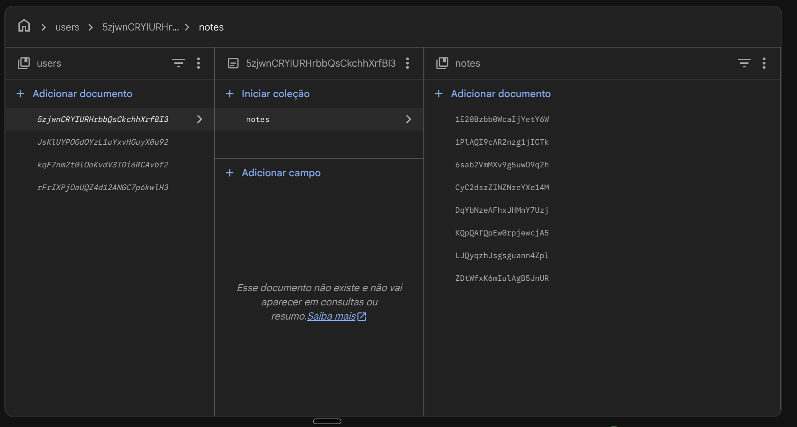
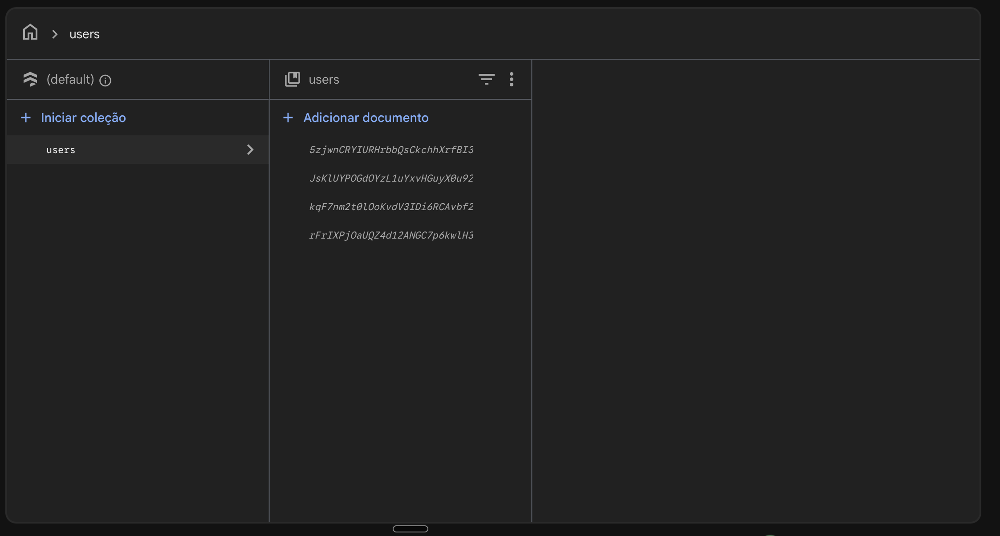

O documento `users/{uid}` aparece em itálico porque o app só grava a subcoleção `notes` e nunca o próprio documento do usuário. Isso é esperado: as notas continuam salvas e acessíveis pelo caminho.

## 9. Estratégia de sincronização e tratamento de erros

### O ciclo: buscar, enviar, mesclar

O ciclo está em `NoteRepository._sync()` (`lib/repositories/note_repository.dart`). Antes de começar, ele confere se há usuário logado e se há rede.

1. **Buscar.** `FirestoreService.fetchAll` baixa todas as notas do usuário em `users/{uid}/notes`.
2. **Enviar.**
   - Cada nota `pending` é gravada no Firestore, menos as que têm uma versão mais nova na nuvem. Depois do envio, `markSynced` marca a nota como `synced`, só se ela não mudou durante o envio (mesmo `updated_at`).
   - Cada nota `pending_purge` é apagada no Firestore e depois no SQLite.
3. **Mesclar.** Para cada ID que existe no aparelho ou na nuvem, `decide()` escolhe o que fazer:

   | Local | Nuvem | Decisão |
   |-------|-------|---------|
   | não existe | existe | grava a da nuvem no SQLite |
   | existe | existe, `updated_at` maior | grava a da nuvem no SQLite |
   | existe | existe, `updated_at` igual ou menor | mantém a local |
   | `synced` | não existe | apaga a local: ela foi excluída de vez em outro aparelho |
   | `pending` ou `pending_purge` | não existe | mantém a local: ainda não foi enviada |

`decide()` é uma função pura, testada em `test/sync_decision_test.dart`.

### Por que buscar antes de enviar

Enviar sem olhar a nuvem pode apagar uma edição mais nova. Exemplo:

1. O aparelho B está offline. Às 10h00 você edita a nota X no B. Ela fica `pending`.
2. No aparelho A, online, você edita a mesma nota às 10h05. Ela sobe para a nuvem.
3. O B volta a ficar online. Se ele enviasse primeiro, gravaria a versão das 10h00 por cima da das 10h05.

Com a busca antes, o B vê que a nuvem tem uma versão mais nova, não envia a dele e baixa a das 10h05.

### Quando a sincronização roda

| Momento | Onde |
|---------|------|
| ao abrir a lista, inclusive logo depois do login | `NotesPage.initState` |
| ao voltar para o app | `didChangeAppLifecycleState`, estado `resumed` |
| quando a conexão volta | `Connectivity().onConnectivityChanged` em `NotesPage.initState` |
| no pull-to-refresh | `NotesPage.refresh` |
| depois de cada alteração | `create`, `update`, `delete`, `restore`, `deletePermanently` e `emptyTrash` chamam `unawaited(sync())` |

### Uma sincronização por vez

A trava é o campo `static Future<SyncResult>? _running` do `NoteRepository`. `sync()` devolve `_running` se já existe uma sincronização rodando, e só começa outra quando ela termina (`whenComplete`). Assim, uma chamada feita no meio de um ciclo recebe o resultado do ciclo atual. O campo é `static` porque cada tela cria o seu `NoteRepository`, e a trava precisa valer para o app inteiro.

### Sem rede, tempo limite e leitura do servidor

- **Sem rede.** Se o `connectivity_plus` informa que não há nenhuma rede, `_sync()` devolve `offline` na hora, sem tentar o Firestore.
- **Tempo limite.** Toda chamada do `FirestoreService` tem `.timeout(Duration(seconds: 10))`. Com a persistência offline desligada, uma chamada sem internet poderia esperar o servidor para sempre. O tempo limite vira `TimeoutException`, tratada como `offline`.
- **Leitura direto do servidor.** `fetchAll` usa `get(const GetOptions(source: Source.server))`. Mesmo com a persistência desligada, o Firestore guarda um cache em memória. Quando o servidor não responde, o `get()` padrão não dá erro: ele devolve esse cache, que pode estar vazio. A mesclagem veria então todas as notas `synced` como "sumiram da nuvem" e apagaria todas do aparelho. Com `Source.server`, o servidor fora do ar vira erro (`unavailable`), tratado como `offline`, e nenhuma nota é apagada. Esse problema foi encontrado nos testes na web e corrigido no commit `29dc66a`.

### Por que a persistência offline do Firestore está desligada

Em `lib/main.dart`: `FirebaseFirestore.instance.settings = const Settings(persistenceEnabled: false);`.

Com a persistência ligada, uma escrita sem internet não falha: ela fica esperando no cache do Firestore e sobe sozinha depois. Nenhum erro chegaria ao app, e quem sincronizaria os dois armazenamentos seria o cache do Firestore, e não o código do app. Desligada, o SQLite é o único armazenamento offline, a sincronização é implementada de verdade no `NoteRepository`, e os erros de conexão chegam ao app e são tratados.

### Tabela de erros

Conferida com o `_sync()` (`lib/repositories/note_repository.dart`) e o `runSync()` (`lib/pages/notes_page.dart`):

| Situação | Resultado | O que o usuário vê | O que acontece com a nota |
|----------|-----------|--------------------|---------------------------|
| nenhuma rede (`connectivity_plus`) | `offline` | aviso "Sem conexão — suas notas serão sincronizadas quando a internet voltar." | continua `pending` |
| `TimeoutException` (10 s), `SocketException`, `FirebaseException` com código `unavailable` ou `deadline-exceeded` | `offline` | o mesmo aviso de sem conexão | continua `pending` |
| outro `FirebaseException`, por exemplo `permission-denied` | `error` | SnackBar "Não foi possível sincronizar. Tente novamente." | continua `pending` |
| qualquer outro erro | `error` | a mesma SnackBar | continua `pending` |
| sincronização com sucesso | `ok` | o aviso de sem conexão some | `synced` |
| pull-to-refresh com sucesso | `ok` | SnackBar "Notas sincronizadas" | `synced` |

A interface nunca espera a rede: as escritas chamam `unawaited(sync())`, e as telas leem do SQLite. Nenhuma nota se perde num erro. O SQLite já tem tudo, a nota continua `pending`, e o próximo ciclo tenta de novo. Se o erro acontece no meio do envio, as notas já enviadas ficam `synced` e o resto continua `pending`.

### Limitações conhecidas

- **"A mais nova vence" usa o relógio de cada aparelho.** O `updated_at` vem de `DateTime.now()` do aparelho que fez a alteração. Um aparelho com o relógio adiantado pode vencer uma edição que foi feita antes, e um com o relógio atrasado pode perder uma edição feita depois.
- **Editar offline vence "excluir definitivamente" em outro aparelho.** Se o aparelho B edita uma nota offline e o aparelho A exclui a mesma nota de vez, o B, ao sincronizar, encontra a nota `pending` e ausente da nuvem, e envia de novo. A nota volta.

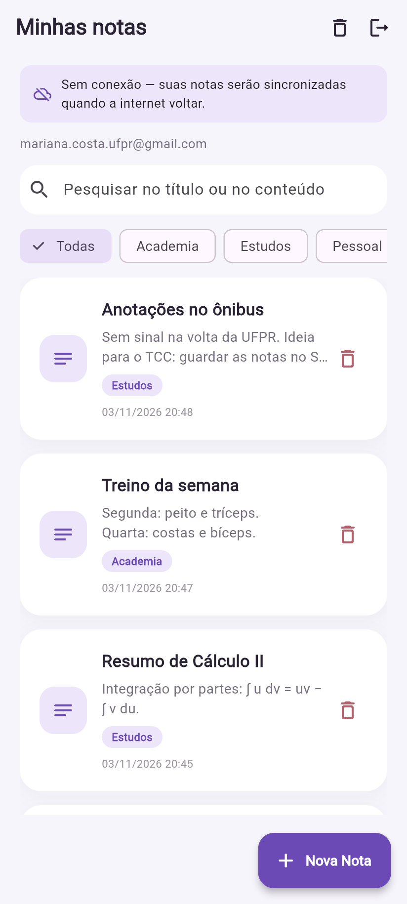
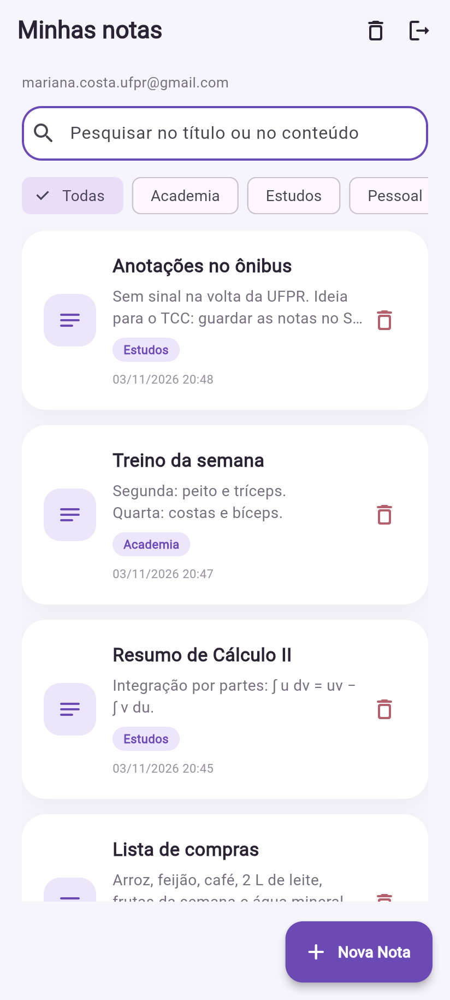
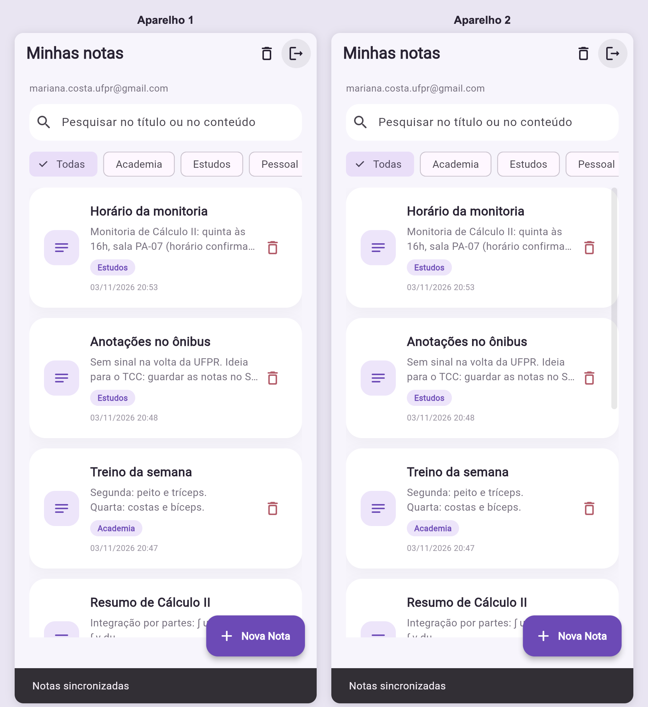

## 10. Autenticação e segurança dos dados

### Login

- O login usa o Firebase Auth com e-mail e senha (`AuthService`, em `lib/services/auth_service.dart`). Erros aparecem como "Não foi possível realizar o login" e "Não foi possivel criar a conta."
- O `uid` do usuário identifica o dono de cada nota. Ele vai no campo `uid` da nota e no caminho do Firestore (`users/{uid}/notes`).
- No aparelho, toda consulta do `DatabaseHelper` filtra por `uid`. Se outra pessoa entrar no mesmo aparelho, ela não vê as notas da primeira.
- O auth gate (seção 7) mostra a `LoginPage` sempre que não há sessão.

### Regras do Firestore

Conteúdo de `firestore.rules`:

```
rules_version = '2';
service cloud.firestore {
  match /databases/{database}/documents {
    match /users/{uid}/notes/{noteId} {
      allow read, delete: if request.auth != null && request.auth.uid == uid;
      // O app confia no campo uid da nota baixada, então ele precisa ser o
      // mesmo dono do caminho.
      allow create, update: if request.auth != null && request.auth.uid == uid
                            && request.resource.data.uid == uid;
    }
  }
}
```

| Linha | O que significa |
|-------|-----------------|
| `rules_version = '2';` | usa a versão 2 da linguagem de regras, a atual |
| `service cloud.firestore {` | as regras abaixo valem para o Cloud Firestore |
| `match /databases/{database}/documents {` | ponto de partida de todo caminho, em qualquer banco do projeto |
| `match /users/{uid}/notes/{noteId} {` | vale para cada documento de nota; `{uid}` e `{noteId}` guardam os pedaços do caminho |
| `allow read, delete: if request.auth != null && request.auth.uid == uid;` | ler (`get` e `list`) e apagar: só com login, e só se o UID de quem pede for o `uid` do caminho |
| `allow create, update: if ... && request.resource.data.uid == uid;` | criar e alterar: as mesmas duas condições, e o campo `uid` do documento enviado precisa ser o `uid` do caminho |

Tudo que não casa com um `allow` é negado. Nenhuma regra fala de outros caminhos, então o resto do banco fica fechado.

**Por que validar o campo `uid`.** O caminho já garante que cada usuário só escreve na própria pasta. Mas o documento também tem um campo `uid`, e o app confia nele: a nota baixada entra no SQLite com esse `uid`, e a lista filtra por ele. Sem a validação, um cliente modificado poderia gravar na própria pasta uma nota com o `uid` de outra pessoa. A regra garante que o campo e o caminho dizem sempre o mesmo dono. `request.resource.data` é o documento como ele fica depois da escrita.

Para publicar as regras:

```
firebase deploy --only firestore:rules --project <ID_DO_PROJETO>
```

Não há print do console para as regras. O teste foi feito pela API REST do Firestore: ler as notas da conta A com o token de ID da conta B devolveu HTTP 403 (`PERMISSION_DENIED`), e a conta A lendo o próprio caminho recebeu 200. As regras estão em `firestore.rules`.

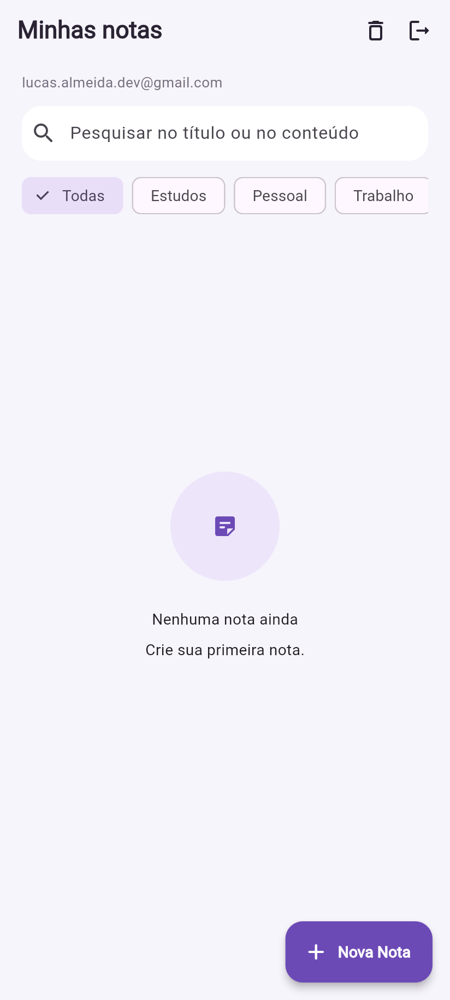

### Por que os arquivos de configuração do Firebase estão no repositório

`lib/firebase_options.dart`, `android/app/google-services.json`, `ios/Runner/GoogleService-Info.plist` e `firebase.json` só têm identificadores públicos do cliente: ID do projeto, ID de cada app, ID do remetente e a chave de API do cliente. Esses valores vão dentro de qualquer app instalado. Qualquer pessoa consegue tirá-los de um APK ou do JavaScript da versão web, e o Firebase não os trata como segredo. A chave de API do cliente só identifica o projeto. Ela não dá acesso aos dados.

Quem protege os dados são o login e as regras do Firestore. Além disso, a professora precisa desses arquivos para rodar o app sem configurar um projeto próprio.

O repositório não tem segredos de verdade: nenhum JSON de conta de serviço (o arquivo com a chave privada do Admin SDK, que ignora as regras), nenhum `.env` e nenhuma chave de assinatura (`.jks`, `.keystore`).

## 11. Prints do app e do Firebase

### Login e notas

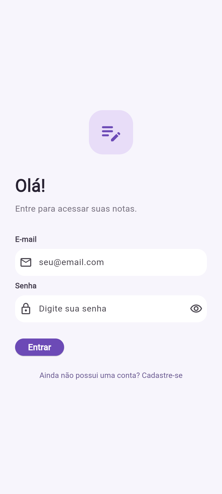
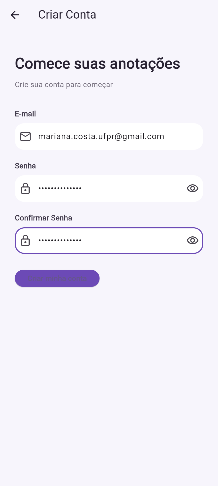


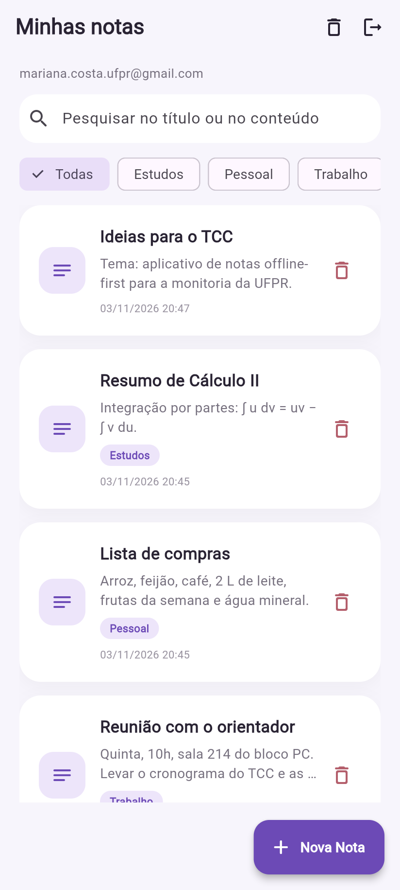

### 2.1 Armazenamento e sincronização


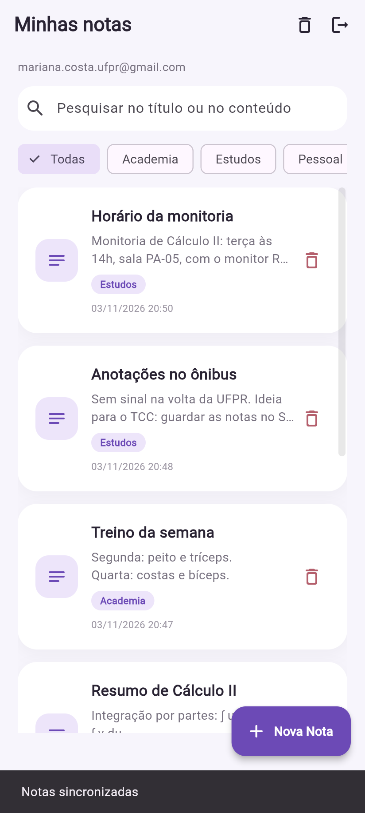
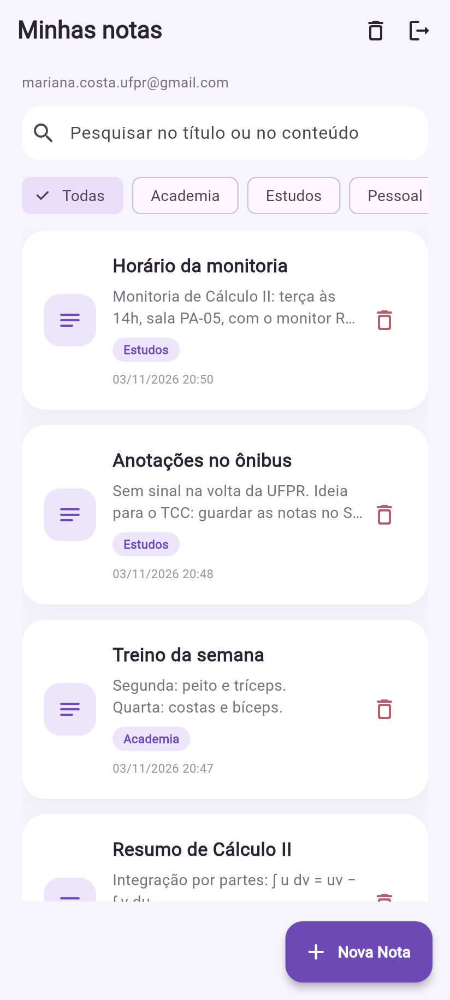


### 2.2 Categorias e pesquisa

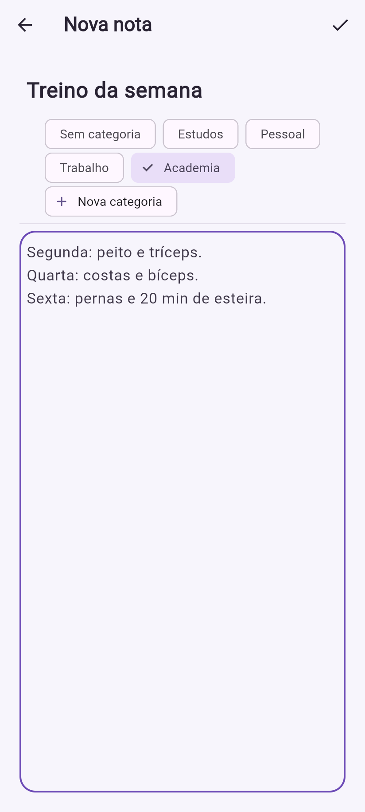
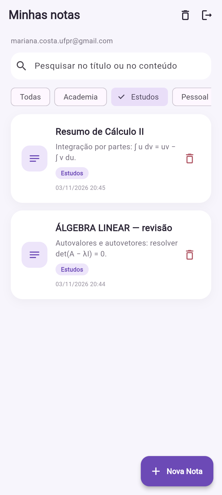

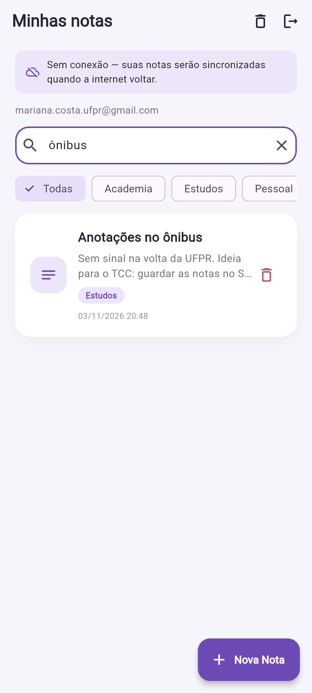
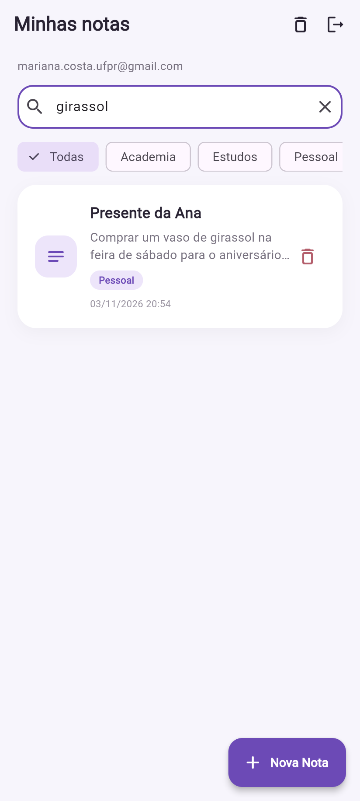

### 2.3 Lixeira

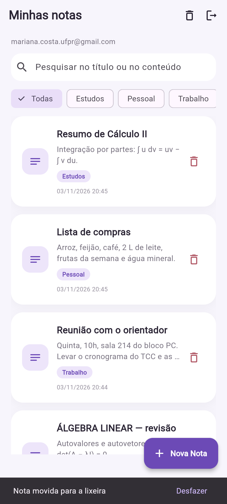
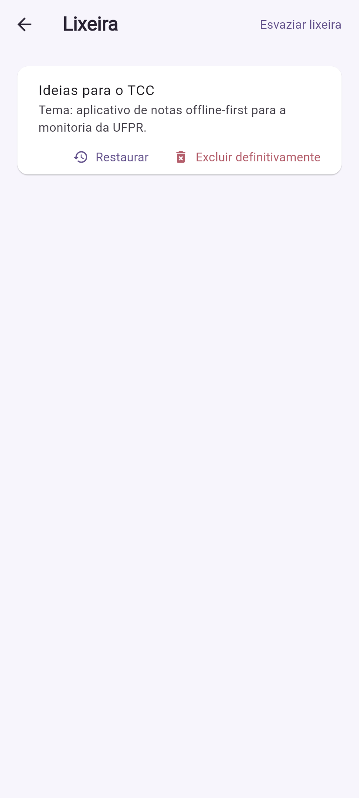


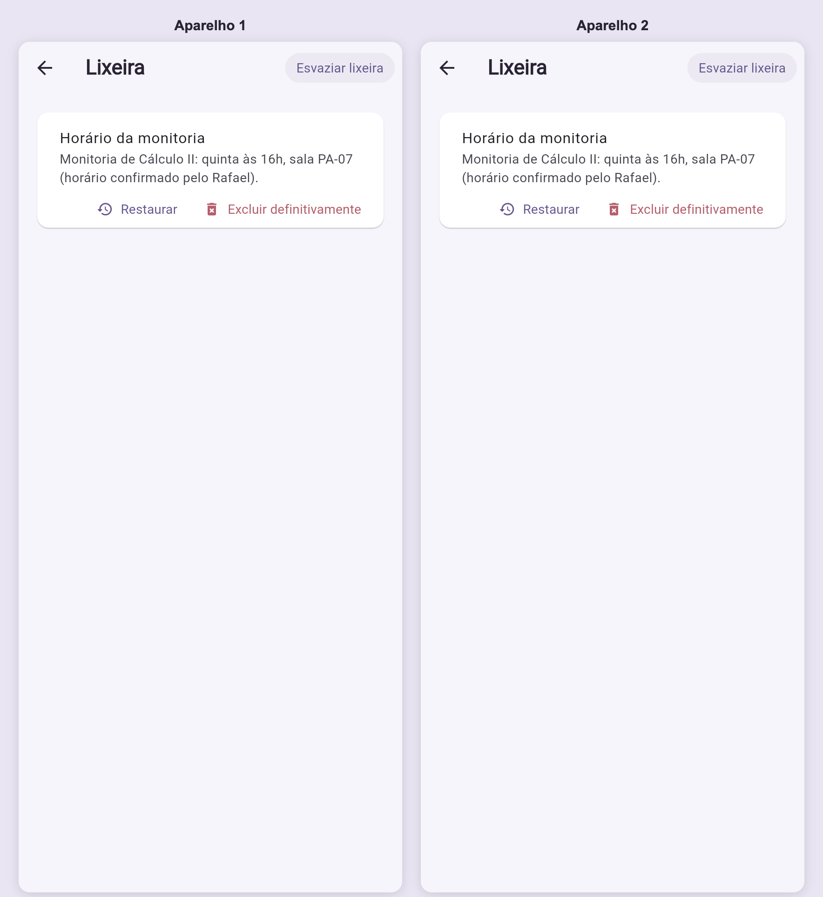

### Console do Firebase

Prova do requisito 2.1: as notas ficam salvas no Cloud Firestore.


O documento `users/{uid}` aparece em itálico porque o app só grava a subcoleção `notes` e nunca o próprio documento do usuário. Isso é esperado: as notas continuam salvas e acessíveis pelo caminho.

Não há print do console para as regras. O teste foi feito pela API REST do Firestore: ler as notas da conta A com o token de ID da conta B devolveu HTTP 403 (`PERMISSION_DENIED`), e a conta A lendo o próprio caminho recebeu 200. As regras estão em `firestore.rules`.

### Verificações

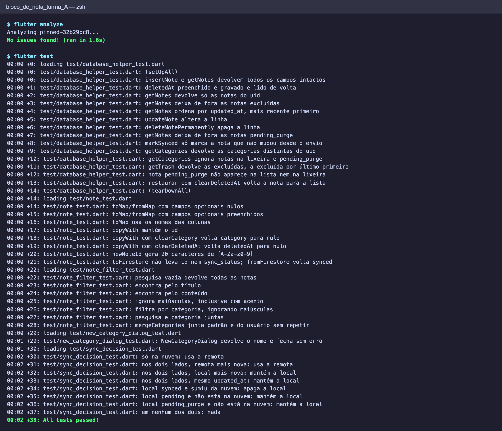
