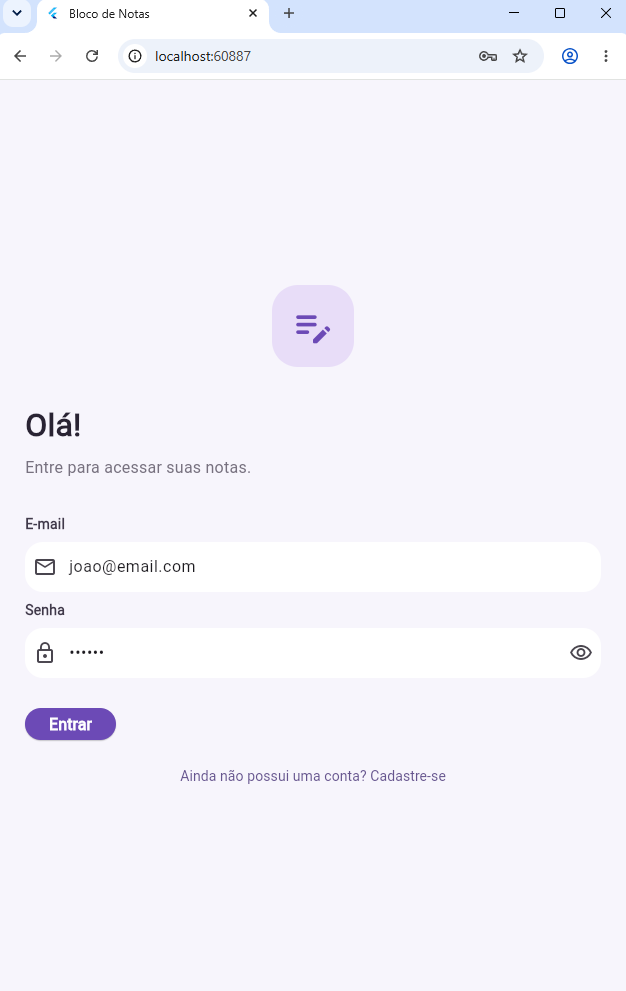
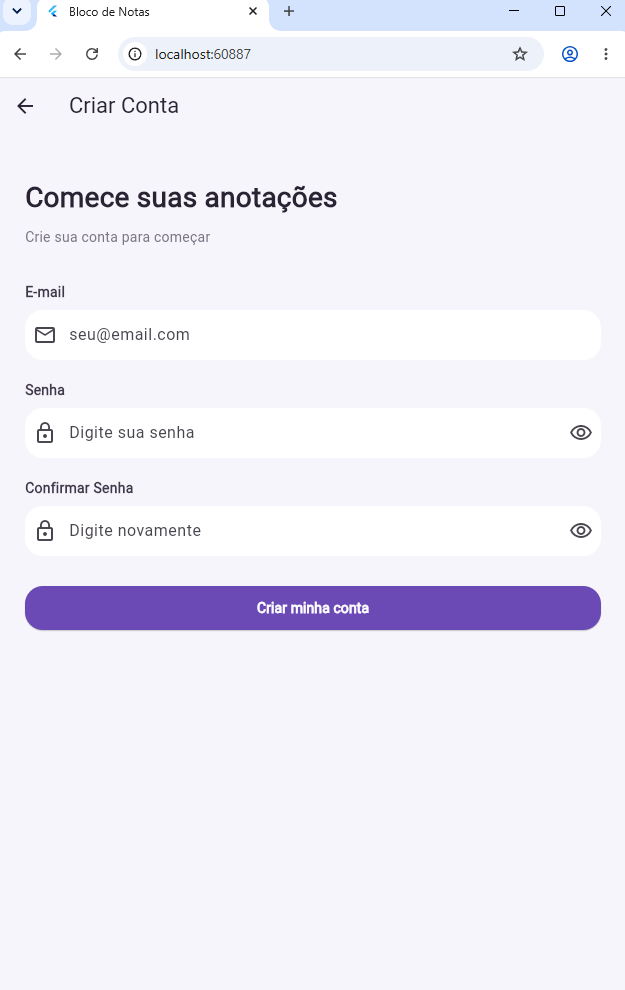
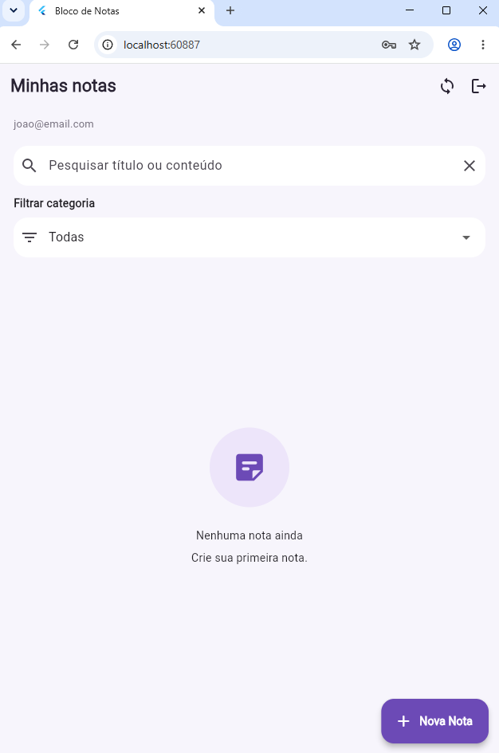
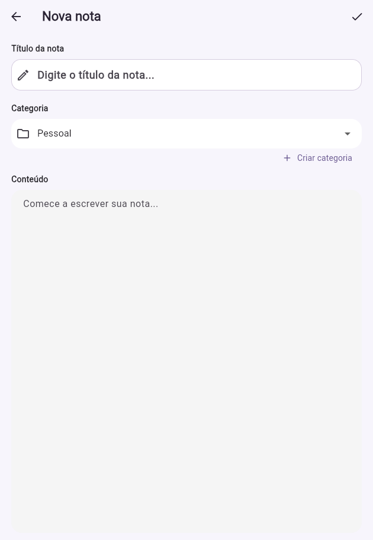
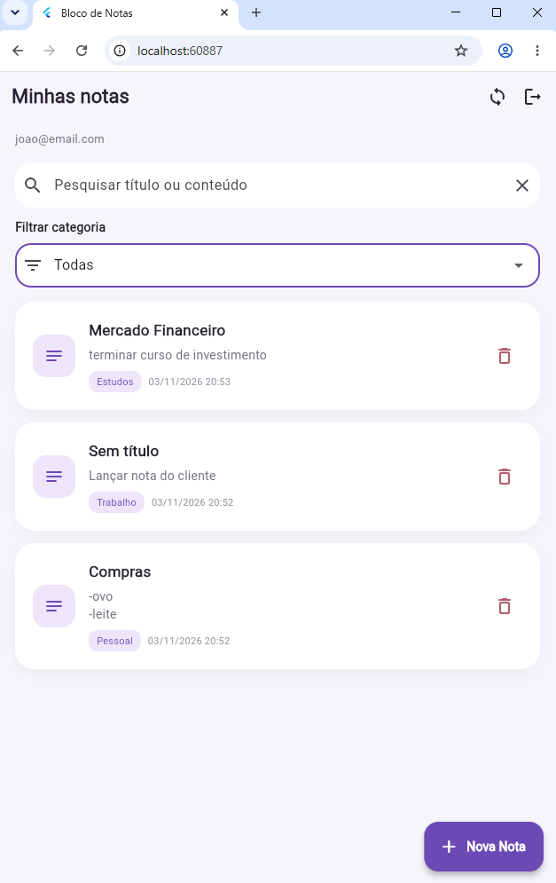
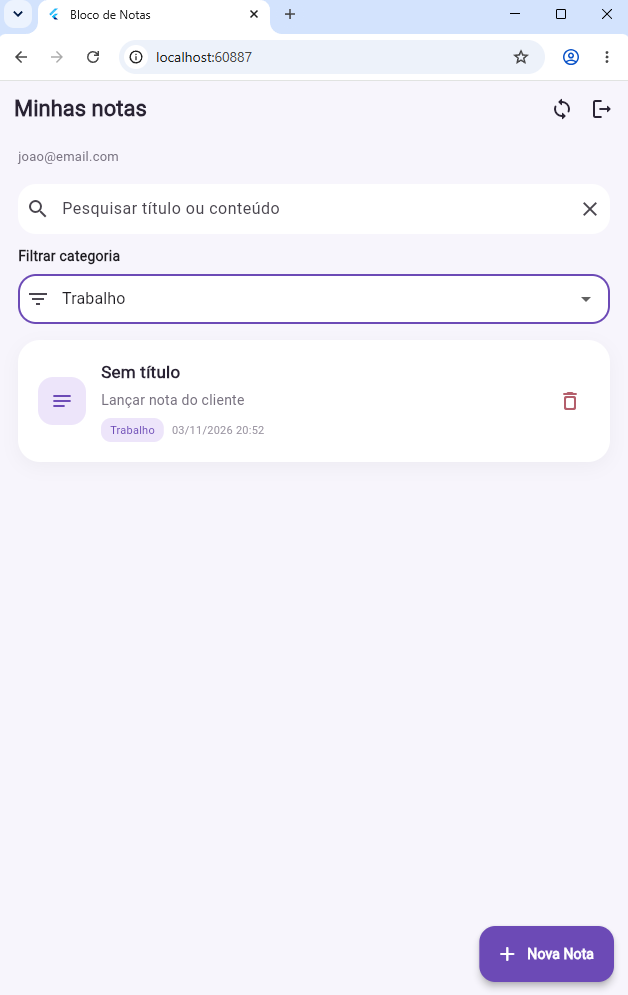
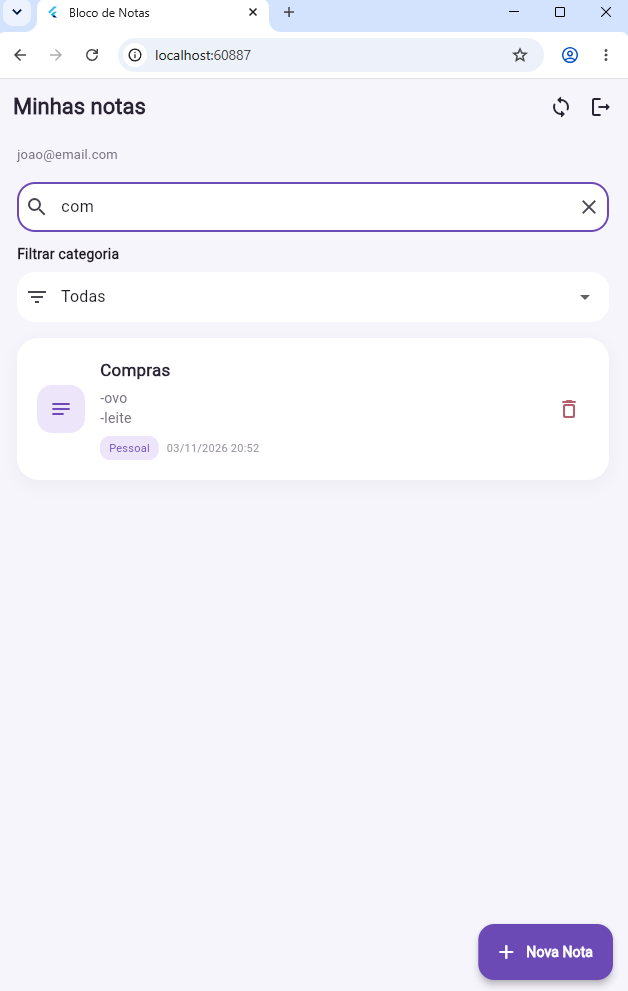
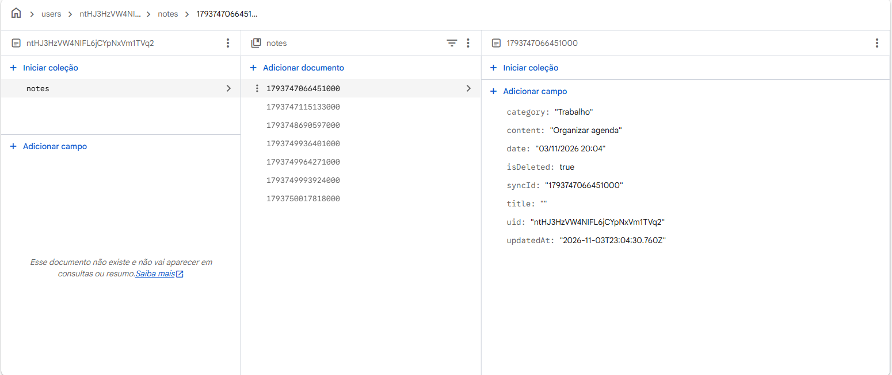
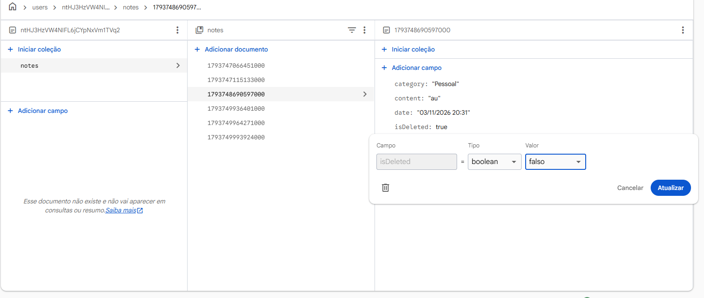

# Bloco de Notas — Flutter

## Sobre o projeto

Este projeto foi desenvolvido para a disciplina de Desenvolvimento Web Mobile, com o objetivo de criar um aplicativo de bloco de notas utilizando Flutter e Dart.

O projeto inicial foi disponibilizado e, a partir dele, foi realizado algumas melhorias e implementado novas funcionalidades, principalmente relacionadas à organização das notas e à integração com o Firebase.

## Funcionalidades implementadas

O aplicativo permite que o usuário:

- Crie uma conta e faça login utilizando e-mail e senha.
- Crie, edite e exclua suas notas.
- Organize as notas por categorias, como Pessoal, Trabalho e Estudos.
- Crie categorias personalizadas.
- Pesquise notas pelo título ou conteúdo.
- Filtre as notas por categoria.
- Visualize as notas ordenadas pela data de atualização, mostrando as mais recentes primeiro.
- Armazene e recupere suas notas utilizando o Firebase Cloud Firestore.

Também foram realizadas melhorias na interface, principalmente nos campos de criação de notas, no filtro de categorias e no botão de cadastro.

## Tecnologias utilizadas

- **Flutter:** desenvolvimento da interface do aplicativo.
- **Dart:** linguagem de programação utilizada.
- **SQLite:** armazenamento local das notas no Android.
- **Firebase Authentication:** cadastro e autenticação dos usuários.
- **Cloud Firestore:** armazenamento das notas na nuvem.
- **Git e GitHub:** controle de versões e organização das alterações.

## Armazenamento e sincronização

O aplicativo utiliza SQLite para armazenar as notas localmente no Android e Cloud Firestore para manter os dados na nuvem.

Quando uma nota é criada, editada ou excluída, o aplicativo tenta sincronizar a alteração com o Firebase. Caso não consiga se conectar, as alterações locais podem ficar pendentes para uma nova tentativa de sincronização.

No navegador, as notas são acessadas diretamente pelo Firestore.

Cada usuário possui suas próprias notas, organizadas no Firebase pelo identificador da conta. As regras de segurança do Firestore são utilizadas para restringir o acesso aos dados de cada usuário.

## Como executar o projeto

Para executar o aplicativo, é necessário ter o Flutter instalado e um projeto Firebase configurado.

Depois de baixar o projeto, abra a pasta no VS Code e execute:

```bash
flutter pub get
flutter run
```

Para utilizar o Firebase, é necessário configurar o Authentication com login por e-mail e senha, criar o banco Cloud Firestore e conectar o projeto ao Flutter utilizando o FlutterFire CLI.

```bash
flutterfire configure
```

Também é necessário publicar as regras de segurança do Firestore.

## Testes

Foram adicionados testes para verificar algumas funcionalidades relacionadas ao modelo de notas e à ordenação dos registros.

Para executar os testes:

```bash
flutter test
```

Além disso, foram realizados testes manuais de cadastro, login, criação, edição, exclusão e recuperação de notas no Firebase.

## Organização do desenvolvimento

Para organizar o trabalho, foi utilizado uma branch chamada `desenvolvimento`, separada da branch principal.

## Capturas de tela

### Tela de login


### Tela de cadastro


### Tela Inicial


### Criação de notas


### Notas Criadas


### Notas Filtradas por Categoria


### Notas Filtradas por Barra de Pesquisa


### Dados no Firebase


### Recuperando dados no Firebase
