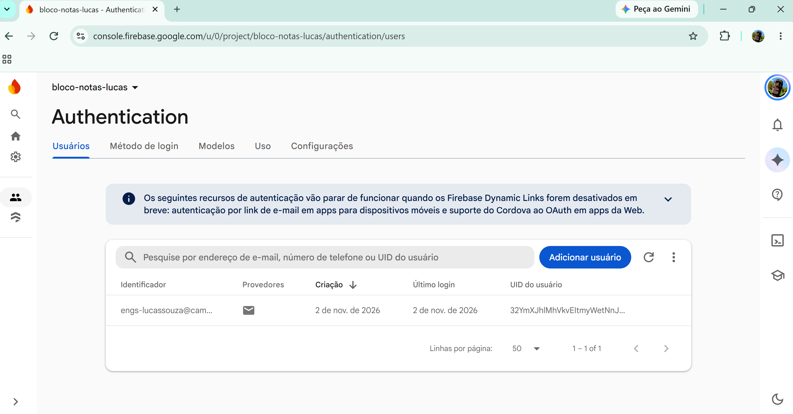
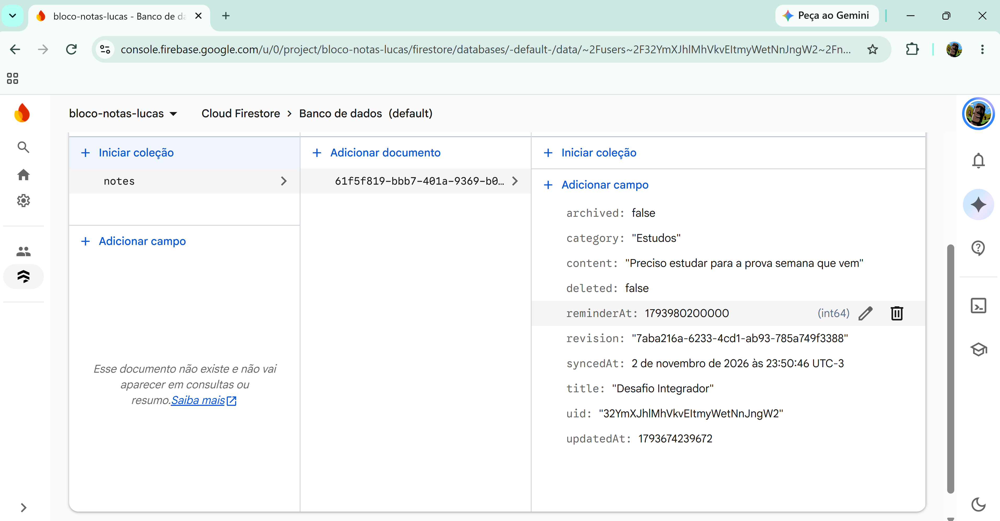
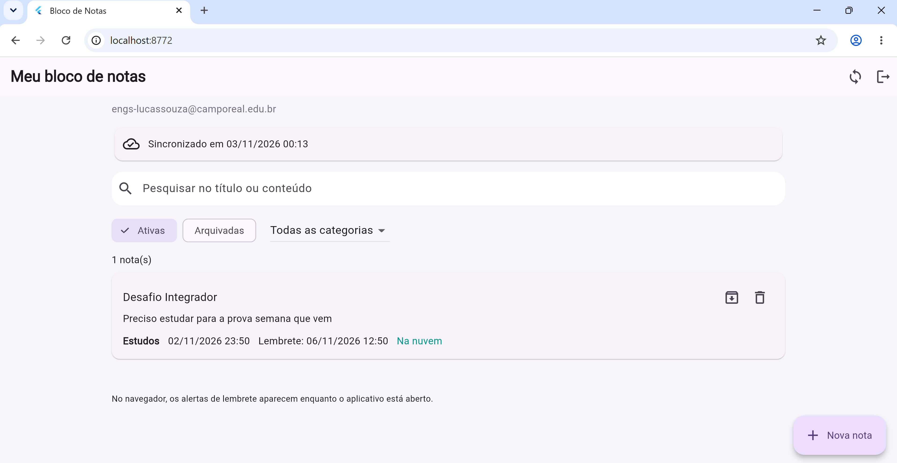
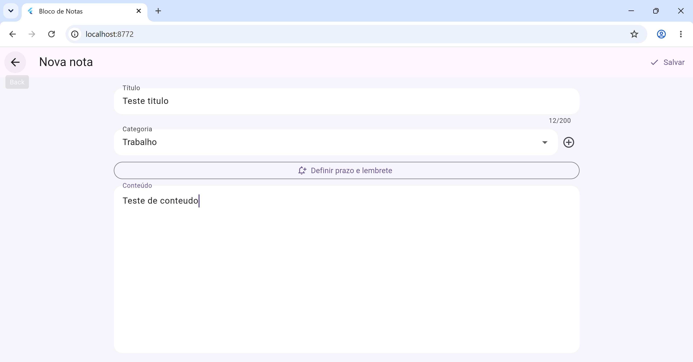
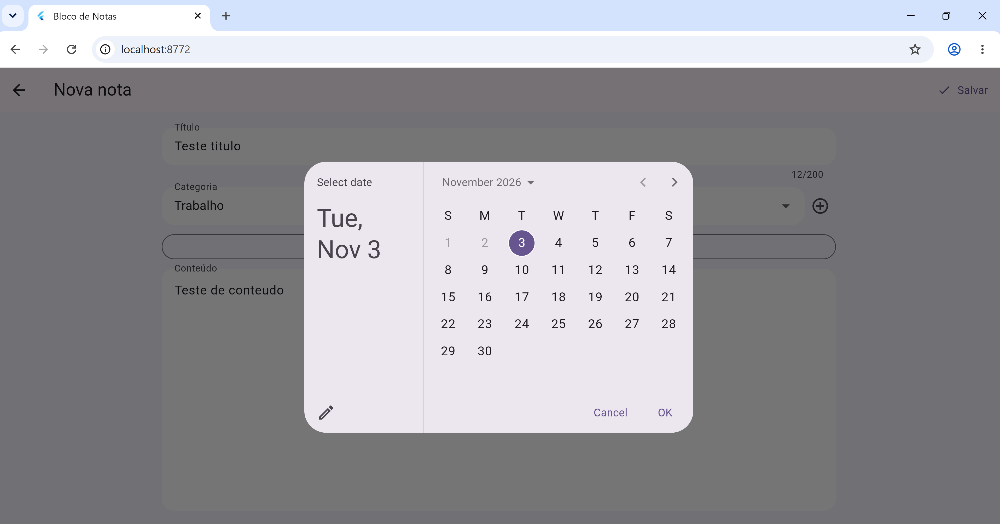
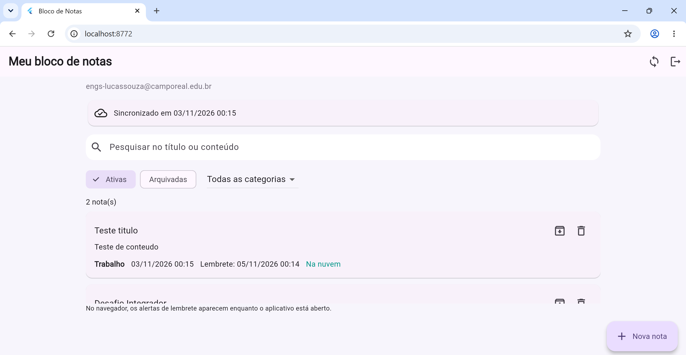

# Bloco de Notas

Aplicativo Flutter para criar e organizar notas, mantendo armazenamento local em SQLite e sincronização com Cloud Firestore. Desenvolvido a partir do projeto disponibilizado para a atividade.

## Funcionalidades

- Cadastro e login por e-mail e senha.
- Criar, consultar, editar e excluir notas.
- Armazenamento local e recuperação das notas da nuvem após login em outra instalação.
- Categorias padrão e criação de categorias próprias.
- Pesquisa por título ou conteúdo e filtro por categoria.
- Arquivamento e desarquivamento de notas.
- Definição de data e horário para lembretes.
- Indicador de sincronização, fila de alterações pendentes e tratamento de falhas de conexão.

## Tecnologias

Flutter, Dart, Firebase Authentication, Cloud Firestore, SQLite (`sqflite`), SQLite Web (`sqflite_common_ffi_web`), `uuid`, `flutter_local_notifications` e `timezone`. As dependências e versões estão em `pubspec.yaml` e `pubspec.lock`.

## Instalação e execução

Pré-requisitos: Flutter compatível com Dart 3.12.2 ou superior e Chrome para execução Web. Para Android, instale o Android SDK e conecte um dispositivo ou emulador.

```sh
flutter pub get
flutter run -d chrome --dart-define-from-file=config/firebase.local.json
```

O arquivo de configuração local deve ser criado conforme as orientações abaixo e não deve ser enviado ao GitHub.

## Configuração do Firebase

1. Crie seu projeto no Console Firebase e registre o aplicativo para a plataforma desejada.
2. Habilite Authentication com o provedor E-mail/senha.
3. Crie um banco Cloud Firestore Standard em modo de produção.
4. Copie `config/firebase.example.json` para `config/firebase.local.json` e preencha com a configuração do seu aplicativo. Para plataformas diferentes, utilize os respectivos dados de configuração.
5. Na Web, confira se o domínio de execução está autorizado no Authentication.
6. Autentique a ferramenta Firebase e publique as regras e os índices:

```sh
npx firebase-tools login
npx firebase-tools deploy --only firestore:rules,firestore:indexes --project SEU_PROJECT_ID
```

O repositório contém somente um modelo de configuração. Senhas, tokens, credenciais administrativas e arquivos específicos do ambiente devem permanecer fora do controle de versão.

## Arquitetura e organização

```text
lib/
  models/        Modelos de nota e categoria e sua serialização
  database/      Esquema SQLite, migração e operações locais
  repositories/  Coordenação do CRUD e da sincronização
  services/      Autenticação, acesso ao Firestore e lembretes
  pages/         Telas de login, cadastro, listagem e formulário
  widgets/       Componentes reutilizáveis da interface
  main.dart      Inicialização e observação da sessão
firestore.rules  Regras de acesso e validação dos dados
config/          Modelo de configuração por ambiente
test/           Testes automatizados
```

### Padrões adotados

- **Repository:** `NotesRepository` centraliza as operações das notas e a sincronização. As telas não gravam diretamente no Firestore.
- **Adapter e injeção de dependências:** `CloudStore` define o contrato remoto e `FirestoreCloudStore` o implementa. Os testes podem substituir o acesso remoto e usar bancos locais isolados.
- **Observer:** `ChangeNotifier` atualiza a listagem quando o repositório muda; `AuthGate` observa a autenticação e descarta o estado da conta anterior.
- **Outbox:** registros locais marcados como pendentes formam uma fila persistente de envio, que sobrevive ao fechamento do aplicativo.

## Armazenamento e sincronização

As notas são salvas primeiro no SQLite. No Android/iOS, o banco fica no armazenamento interno do aplicativo. Na Web, SQLite WebAssembly persiste os dados no IndexedDB do navegador.

Cada nota possui um identificador local, um UUID para identificação entre instalações e o identificador do usuário proprietário. Notas e categorias ficam em subcoleções privadas de cada usuário no Firestore.

A sincronização ocorre ao entrar, salvar uma alteração, retomar o aplicativo, pressionar o botão de sincronização e periodicamente:

1. Salva a alteração localmente e marca o registro como pendente.
2. Envia os registros pendentes ao Firestore.
3. Após a confirmação do servidor, remove a pendência apenas da revisão enviada. Edições feitas durante o envio permanecem pendentes.
4. Consulta os dados do servidor e atualiza o SQLite, preservando alterações locais ainda não enviadas.

A mesma conta recupera suas notas ao entrar em outra instalação. A migração do banco anterior preserva as notas existentes.

**Conflitos:** entre edições, prevalece a última transação aceita pelo servidor. Exclusões confirmadas prevalecem sobre edições antigas feitas offline.

**Exclusão:** utiliza um marcador de exclusão nos dois armazenamentos. A nota deixa de aparecer na interface, mas o marcador é mantido para propagar a exclusão a outras instalações.

**Erros:** operações remotas têm timeout e mostram uma mensagem quando falham. O conteúdo local e as pendências são preservados para uma nova tentativa. Falhas no salvamento local são informadas sem descartar o texto do formulário.

**Pesquisa:** funciona sobre as notas locais, incluindo as recuperadas da nuvem. Pesquisa título e conteúdo sem diferenciar maiúsculas e minúsculas, respeitando a categoria e a aba de notas ativas ou arquivadas.

## Lembretes

O prazo é salvo e sincronizado em UTC e exibido no horário local do dispositivo. Editar o prazo reagenda o lembrete; arquivar ou excluir cancela o agendamento.

Na Web, os lembretes aparecem dentro do aplicativo enquanto ele está aberto e são verificados ao retomar a aba. No Android/iOS, são utilizadas notificações locais mediante permissão. A entrega nativa ainda precisa ser validada em dispositivo físico; no Android, o sistema pode atrasar notificações inexatas por economia de bateria.

## Autenticação e segurança

O aplicativo usa Firebase Authentication. Consultas e alterações locais incluem o proprietário. As regras do Firestore verificam o usuário autenticado, impedem acesso entre contas e troca de proprietário e validam os campos enviados.

O SQLite/IndexedDB não é criptografado por esta implementação. Limpar os dados do aplicativo remove o armazenamento local; alterações ainda pendentes não estarão disponíveis na nuvem. As regras devem ser revisadas antes de uma disponibilização ampla.

## Testes

```sh
flutter analyze
flutter test
npm ci
npm run test:rules
```

Os testes cobrem migração, persistência, sincronização offline, recuperação em outra instalação, edição durante o envio, exclusão, pesquisa, categorias, arquivamento, lembretes e isolamento entre usuários. Os testes das regras utilizam o emulador oficial do Firestore.

Para executar sem um projeto Firebase, inicie `npm run emulators` e rode:

```sh
flutter run -d chrome --dart-define=USE_FIREBASE_EMULATORS=true
```

Os testes de navegador estão em `test/browser`. Para reproduzi-los, compile com `flutter build web --debug --output build/emulator-web --dart-define=USE_FIREBASE_EMULATORS=true`, sirva com `npm run serve:web` e execute `npm run test:e2e`, mantendo os emuladores ativos. Os testes de navegador usam contas fictícias.

## Capturas de tela

### Firebase

#### Autenticação

Usuário cadastrado no Firebase Authentication.



#### Armazenamento das notas

Nota armazenada no Cloud Firestore, com título, conteúdo, categoria e prazo de lembrete.



### Funcionamento do aplicativo

#### Nota sincronizada

Listagem de uma nota com categoria, lembrete e confirmação de armazenamento na nuvem.



#### Cadastro de nota

Formulário para preencher título, categoria e conteúdo.



#### Definição de lembrete

Seleção da data para o prazo e o lembrete da nota.



#### Notas com lembretes

Listagem das notas cadastradas, com suas categorias e datas de lembrete.


