# Bloco de Notas - Turma A

Aplicativo de bloco de notas feito em Flutter. Ele parte do projeto que a professora passou em aula (login com Firebase Authentication e notas salvas no SQLite) e acrescenta a integração com o **Cloud Firestore**, **categorias**, **pesquisa**, **lixeira** e **ordenação por data**.

O objetivo é que o usuário consiga usar as notas mesmo sem internet (tudo fica salvo no SQLite do aparelho) e que, quando houver conexão, as notas sejam enviadas para o Firebase. Assim ele recupera as notas ao entrar de novo no app ou em outra instalação.

## Sumário

- [Funcionalidades](#funcionalidades)
- [Tecnologias e dependências](#tecnologias-e-dependências)
- [Como executar](#como-executar)
- [Configurando o Firebase](#configurando-o-firebase)
- [Arquitetura e organização dos arquivos](#arquitetura-e-organização-dos-arquivos)
- [Padrões de projeto](#padrões-de-projeto)
- [Armazenamento local e Firebase](#armazenamento-local-e-firebase)
- [Sincronização e tratamento de erros](#sincronização-e-tratamento-de-erros)
- [Autenticação e segurança](#autenticação-e-segurança)
- [Testes](#testes)
- [Capturas de tela](#capturas-de-tela)
- [O que foi alterado em relação ao projeto base](#o-que-foi-alterado-em-relação-ao-projeto-base)

## Funcionalidades

**Do projeto base (mantidas):**

- Cadastro e login com e-mail e senha (Firebase Authentication).
- Criar, listar, editar e excluir notas.

**Novas:**

- **Integração com o Cloud Firestore:** as notas são salvas no SQLite e também no Firestore, cada uma ligada ao usuário logado (`uid`).
- **Sincronização:** ao abrir o app, depois de cada alteração e pelo botão de sincronizar, o app envia o que está pendente e baixa o que veio da nuvem. Cada nota mostra um ícone de nuvem indicando se já foi enviada.
- **Funciona sem internet:** as notas continuam sendo criadas, editadas e excluídas no SQLite. Quando o Firebase não responde, aparece um aviso e as alterações são enviadas depois.
- **Login salvo:** se o usuário já entrou antes, o app abre direto na lista de notas, mesmo offline.
- **Categorias:** cada nota tem uma categoria. Já vêm criadas "Estudos", "Trabalho" e "Pessoal", e o usuário pode criar outras pelo botão "Nova categoria" na tela da nota. Na lista dá para filtrar por categoria.
- **Pesquisa:** campo de busca que procura o texto no título ou no conteúdo das notas e mostra quantas foram encontradas. Funciona junto com o filtro de categoria.
- **Lixeira com recuperação (funcionalidade adicional):** excluir uma nota manda ela para a lixeira (com opção "Desfazer"). Na lixeira dá para restaurar, excluir definitivamente ou esvaziar tudo. Notas que ficam mais de 30 dias na lixeira são excluídas automaticamente.
- **Ordenação por data (funcionalidade adicional):** a lista pode ser ordenada pela última atualização, pela data de criação mais recente ou pela mais antiga.
- **Regras de segurança do Firestore:** um usuário não consegue ler nem alterar as notas de outro.
- Mensagens de erro mais claras no login e no cadastro (sem internet, e-mail já cadastrado, senha fraca).

## Tecnologias e dependências

| Tecnologia | Para que foi usada |
| --- | --- |
| Flutter 3.47 / Dart 3.13 | Desenvolvimento do aplicativo |
| `firebase_core` | Inicializar o Firebase |
| `firebase_auth` | Cadastro, login e logout |
| `cloud_firestore` | Banco de dados na nuvem |
| `sqflite` | Banco SQLite local no Android/iOS |
| `sqflite_common_ffi_web` | SQLite no navegador (para rodar o app no Chrome) |
| `path` | Montar o caminho do arquivo do banco |
| `flutter_lints` / `flutter_test` | Análise do código e testes |

Ferramentas usadas na configuração: Firebase CLI (`firebase-tools`) e FlutterFire CLI (`flutterfire_cli`).

## Como executar

Pré-requisitos: Flutter instalado (`flutter doctor` sem erros para a plataforma que for usar), Node.js (para o Firebase CLI) e uma conta Google para criar o projeto no Firebase.

1. Clone o repositório e entre na branch `desenvolvimento`:

   ```bash
   git clone https://github.com/emanuelstefaness/bloco_de_nota_turma_A.git
   cd bloco_de_nota_turma_A
   git checkout desenvolvimento
   ```

2. Instale as dependências:

   ```bash
   flutter pub get
   ```

3. Configure o Firebase seguindo a seção [Configurando o Firebase](#configurando-o-firebase). Sem esse passo o projeto não compila, porque o arquivo `lib/firebase_options.dart` não está no repositório.

4. Execute:

   ```bash
   # celular Android conectado ou emulador
   flutter run

   # navegador (Chrome)
   flutter run -d chrome --web-port 5000
   ```

   No navegador é bom usar sempre a mesma porta, porque o banco local fica guardado no IndexedDB do endereço (`localhost:5000`).

Os arquivos `web/sqflite_sw.js` e `web/sqlite3.wasm` já estão no repositório. Eles são necessários para o SQLite funcionar no navegador e foram gerados com `dart run sqflite_common_ffi_web:setup`.

## Configurando o Firebase

Os arquivos de configuração do Firebase (`lib/firebase_options.dart`, `android/app/google-services.json` e `ios/Runner/GoogleService-Info.plist`) **não ficam no repositório** (estão no `.gitignore`). Cada pessoa gera os seus a partir do próprio projeto do Firebase:

1. Acesse o [console do Firebase](https://console.firebase.google.com/) e crie um projeto.
2. Em **Authentication > Sign-in method**, ative o provedor **E-mail/senha**.
3. Em **Firestore Database**, clique em **Criar banco de dados** e escolha o **modo de produção** (as regras deste repositório serão publicadas no passo 6).
4. Instale as ferramentas e faça login (no Windows, o `npm install` tem que ser feito no CMD):

   ```bash
   npm install -g firebase-tools
   dart pub global activate flutterfire_cli
   firebase login
   ```

5. Na pasta do projeto, gere a configuração do app:

   ```bash
   flutterfire configure --project=ID_DO_SEU_PROJETO --platforms=android,web
   ```

   Esse comando registra os apps no Firebase e cria o `lib/firebase_options.dart` e o `android/app/google-services.json`.

6. Publique as regras de segurança que estão no arquivo `firestore.rules`:

   ```bash
   firebase deploy --only firestore:rules --project ID_DO_SEU_PROJETO
   ```

   (Também dá para copiar o conteúdo do `firestore.rules` e colar em **Firestore Database > Regras** no console.)

A chave que aparece no `firebase_options.dart` não é uma senha. Ela só identifica o projeto, e quem protege os dados são as regras do Firestore. Mesmo assim, esses arquivos ficam fora do repositório porque dependem do projeto de cada um, como foi pedido na atividade.

## Arquitetura e organização dos arquivos

```
lib/
├── main.dart                      inicia o Firebase, configura o SQLite e escolhe a tela inicial
├── firebase_options.dart          gerado pelo flutterfire configure (não versionado)
├── models/
│   └── note.dart                  model Note + conversões para SQLite (toMap) e Firestore (toFirestore)
├── database/
│   └── database_helper.dart       acesso ao SQLite (tabelas notes e categories)
├── services/
│   ├── auth_service.dart          login, cadastro e logout no Firebase Auth
│   └── firestore_service.dart     leitura, gravação e exclusão das notas no Firestore
├── repositories/
│   └── note_repository.dart       junta SQLite + Firestore e faz a sincronização
├── pages/
│   ├── login_page.dart
│   ├── register_page.dart
│   ├── notes_page.dart            lista, pesquisa, filtro de categoria, ordenação e sincronização
│   ├── note_form_page.dart        criar/editar nota e escolher ou criar categoria
│   └── trash_page.dart            lixeira
└── widgets/
    └── note_card.dart             card da nota (categoria, data e status da sincronização)

firestore.rules                    regras de segurança do Firestore
firebase.json                      aponta para o firestore.rules (usado no firebase deploy)
test/note_test.dart                testes do model Note
```

O app está dividido em camadas:

```
Telas (pages / widgets)
        │
        ▼
NoteRepository  ──────────────►  FirestoreService  ──►  Cloud Firestore
        │
        ▼
DatabaseHelper  ──►  SQLite (no aparelho)
```

As telas não acessam o SQLite nem o Firestore diretamente: elas chamam o `NoteRepository`. Ele grava sempre primeiro no SQLite e, na sincronização, conversa com o Firestore pelo `FirestoreService`. A parte de login continua com o `AuthService`, como no projeto base.

## Padrões de projeto

- **Singleton** (`DatabaseHelper`): já vinha do projeto base. Existe uma única instância (`DatabaseHelper.instance`) com o construtor privado `_init()`, e o banco é aberto uma vez só e reaproveitado (`_database`). Assim não abrimos várias conexões com o mesmo arquivo `notes.db`.
- **Repository** (`NoteRepository`): é o único lugar que sabe que existem dois bancos. As telas chamam `saveNote`, `moveToTrash`, `getNotes`, `syncNotes` etc. e não precisam saber se o dado veio do SQLite ou do Firestore. Se um dia trocarmos o Firestore por outro serviço, as telas não mudam.
- **Service** (`AuthService` e `FirestoreService`): cada serviço externo fica isolado em uma classe. O `FirestoreService` só sabe ler, salvar e excluir documentos em `users/{uid}/notes`. Quem decide quando chamar é o repository.
- **Factory constructor / conversão de dados** (`Note.fromMap` e `Note.fromFirestore`): o model sabe se converter de e para o formato de cada banco. O `toMap` tem todos os campos (inclusive os de controle que só existem no SQLite, como `synced` e `deleted`) e o `toFirestore` manda só o que interessa na nuvem. O `copyWith` cria uma cópia da nota mudando só alguns campos, o que é usado na lixeira e na sincronização.
- **Offline first**: a estratégia de dados do app. A tela sempre lê do SQLite, que é rápido e funciona sem internet, e o Firestore funciona como cópia na nuvem, sincronizada quando possível.

## Armazenamento local e Firebase

### SQLite (local)

O banco `notes.db` está na **versão 3**. Tabela `notes`:

| Coluna | Tipo | Descrição |
| --- | --- | --- |
| `id` | INTEGER | chave primária local (autoincremento) |
| `firebaseId` | TEXT | id do documento da nota no Firestore |
| `uid` | TEXT | usuário dono da nota |
| `title`, `content` | TEXT | título e texto |
| `category` | TEXT | nome da categoria |
| `date` | TEXT | data formatada da última edição (mostrada no card) |
| `createdAt`, `updatedAt` | INTEGER | datas em milissegundos (ordenação e sincronização) |
| `synced` | INTEGER | 1 = já está no Firebase, 0 = falta enviar |
| `trashed` | INTEGER | 1 = está na lixeira |
| `deleted` | INTEGER | 1 = excluída definitivamente, falta apagar no Firebase |

Tabela `categories`: `id`, `uid` e `name`, com um índice `UNIQUE (uid, name)` para o mesmo usuário não ter categorias repetidas.

As migrações ficam no `onUpgrade`, então quem já tinha o banco instalado não perde as notas:

- **versão 1 → 2:** adiciona as colunas novas com `ALTER TABLE`, cria a tabela de categorias e gera um `firebaseId` para as notas antigas.
- **versão 2 → 3:** nos testes apareceu a categoria "Estudos" duplicada, porque a tela e a sincronização criavam as categorias padrão ao mesmo tempo. A migração apaga as repetidas e cria o índice `UNIQUE`, e o `insertCategory` passou a usar `ConflictAlgorithm.ignore`.

O `CREATE TABLE` do projeto base tinha uma vírgula sobrando depois da última coluna, o que gerava erro de sintaxe na criação do banco. Isso foi corrigido.

No navegador o `sqflite` não funciona sozinho, então no `main.dart` trocamos a `databaseFactory` pela do `sqflite_common_ffi_web` quando `kIsWeb` é verdadeiro. Nesse caso o banco fica salvo no IndexedDB do navegador.

### Cloud Firestore (nuvem)

Cada usuário tem a sua coleção de notas:

```
users (coleção)
└── {uid do usuário} (documento)
    └── notes (subcoleção)
        └── {firebaseId} (documento)
            ├── uid: "..."
            ├── title: "..."
            ├── content: "..."
            ├── category: "Estudos"
            ├── date: "05/11/2026 14:30"
            ├── createdAt: 1793900000000
            ├── updatedAt: 1793900000000
            └── trashed: false
```

O id do documento (`firebaseId`) é gerado no próprio aparelho, no momento em que a nota é criada (`collection.doc().id`), sem precisar de internet. Por isso a mesma nota tem o mesmo id no SQLite e no Firestore, e enviar de novo não cria nota duplicada (o `set` só sobrescreve o documento).

As categorias vão para o Firestore junto com cada nota (campo `category`). Quando o app baixa as notas em outra instalação, as categorias que aparecem nelas são recriadas no SQLite.

O cache offline do próprio Firestore foi desligado (`persistenceEnabled: false`), porque quem guarda os dados offline é o SQLite. Assim só existe uma cópia local e fica claro quando a nota chegou de verdade no servidor.

## Sincronização e tratamento de erros

Toda alteração (criar, editar, mandar para a lixeira, restaurar, excluir) é gravada **primeiro no SQLite** com `synced = 0`. Em seguida a tela de notas chama o `syncNotes` do repository, que também roda ao abrir o app e quando o usuário toca no botão de sincronizar.

O `syncNotes(uid)` faz três passos:

1. **Baixa as notas do Firestore** (`get` com `Source.server`, ou seja, direto do servidor).
   - Nota que não existe no SQLite é inserida (veio de outro aparelho ou de uma instalação anterior).
   - Nota que existe nos dois lugares é atualizada no SQLite se a versão do Firebase tiver o `updatedAt` maior. Se a nota foi alterada nos dois lugares, **fica valendo a alteração mais recente** (last write wins).
   - A categoria de cada nota é recriada no SQLite se não existir.
2. **Remove do SQLite** as notas que estavam sincronizadas (`synced = 1`) mas não existem mais no Firestore, ou seja, que foram excluídas em outro aparelho.
3. **Envia o que está pendente** (`synced = 0`): notas com `deleted = 1` são apagadas no Firestore e depois no SQLite. As outras são gravadas com `set` e marcadas como `synced = 1`. O `markAsSynced` compara o `updatedAt`, então se o usuário editar a nota enquanto ela está sendo enviada, ela continua pendente.

**Tratamento de erros:**

- Cada chamada ao Firestore tem um tempo limite de 10 segundos (`timeout`). Sem internet, a busca no servidor dá erro ou estoura o tempo.
- Qualquer erro (sem internet, Firebase fora do ar, regra bloqueando) é capturado no `try/catch` do `syncNotes`, que retorna `false`. Nada é perdido, porque as alterações continuam no SQLite com `synced = 0` e são enviadas na próxima sincronização.
- Quando a sincronização falha, a tela mostra o aviso "Sem conexão com o Firebase..." e as notas pendentes ficam com o ícone de nuvem com seta.
- Se o passo 1 falhar, os passos 2 e 3 não rodam. Isso evita apagar notas locais por engano quando a lista do servidor não foi carregada.
- A tela evita duas sincronizações ao mesmo tempo: se uma alteração acontecer durante a sincronização, ela roda de novo quando a primeira terminar (`syncAgain`).
- No login e no cadastro, os erros do Firebase Auth são tratados pelo código (`network-request-failed`, `email-already-in-use`, `weak-password`...) para mostrar uma mensagem que o usuário entenda.

**Limitações:** a comparação usa a hora do aparelho, então um relógio muito errado pode fazer uma versão antiga ganhar. Categorias criadas e nunca usadas em nenhuma nota ficam só no aparelho em que foram criadas.

## Autenticação e segurança

- O login é feito com o **Firebase Authentication** (e-mail e senha). Toda nota guarda o `uid` do usuário, tanto no SQLite (todas as consultas usam `where uid = ?`) quanto no Firestore (caminho `users/{uid}/notes`).
- O app só abre a tela de notas se existir um usuário logado. Se o usuário já tinha entrado antes, o Firebase lembra a sessão e o app abre direto nas notas.
- As **regras do Firestore** (`firestore.rules`) garantem a segurança no servidor, mesmo que alguém tente acessar o banco sem passar pelo app:

  ```
  match /users/{userId}/notes/{noteId} {
    allow read, delete: if request.auth != null
                        && request.auth.uid == userId;

    allow create, update: if request.auth != null
                          && request.auth.uid == userId
                          && request.resource.data.uid == userId
                          && request.resource.data.title is string
                          && request.resource.data.content is string;
  }
  ```

  Ou seja, só quem está logado com o mesmo `uid` do caminho consegue ler, criar, editar ou apagar as notas. Ao gravar, o campo `uid` da nota também precisa ser o do usuário logado, e título e conteúdo precisam ser texto. Qualquer outro caminho do banco não tem regra e por isso fica bloqueado.
- Nenhuma senha, chave ou arquivo de credencial foi colocado no repositório. Os arquivos gerados pelo `flutterfire configure` estão no `.gitignore`.

## Testes

- `test/note_test.dart`: testes do model `Note` (conversão para SQLite e Firestore, `copyWith`). Para rodar:

  ```bash
  flutter test
  ```

  O teste padrão do contador (`widget_test.dart`) foi removido porque não tinha relação com o app e falhava.

- Testes manuais feitos no app:
  - cadastro, login e logout;
  - criar, editar, mandar para a lixeira, desfazer, restaurar e excluir definitivamente, conferindo no Firestore depois de cada operação;
  - criar categoria nova, filtrar por categoria, pesquisar e ordenar;
  - Firebase fora do ar: criar e editar notas (ficaram pendentes com o aviso na tela) e, quando a conexão voltou, sincronizar e conferir que chegaram no Firestore;
  - instalação nova: apagar o banco local, entrar de novo e ver as notas, as categorias e a lixeira voltarem do Firestore;
  - regras de segurança: com um segundo usuário, tentar listar, ler, criar e apagar notas do primeiro (todas bloqueadas com erro 403), tentar acessar sem login (bloqueado) e tentar salvar uma nota com o `uid` de outra pessoa (bloqueado).

## Capturas de tela

As telas abaixo foram capturadas com o app rodando no Chrome em tamanho de celular (`flutter run -d chrome`).

### Aplicativo

| Login | Lista de notas | Nota com categoria |
| :---: | :---: | :---: |
| 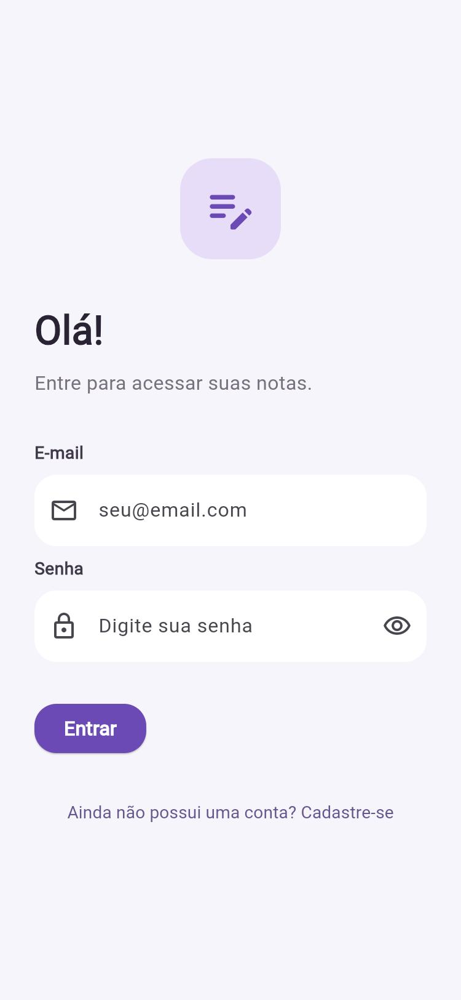 | 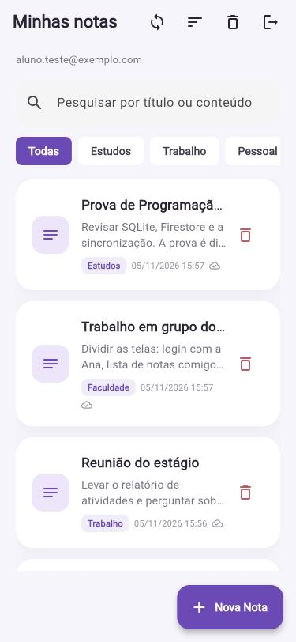 | 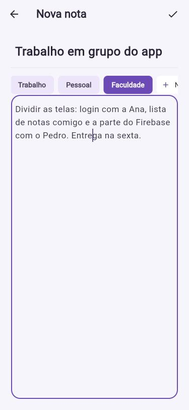 |

| Nova categoria | Pesquisa | Filtro + ordenação |
| :---: | :---: | :---: |
| 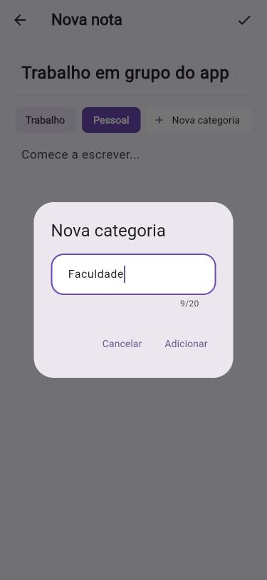 | 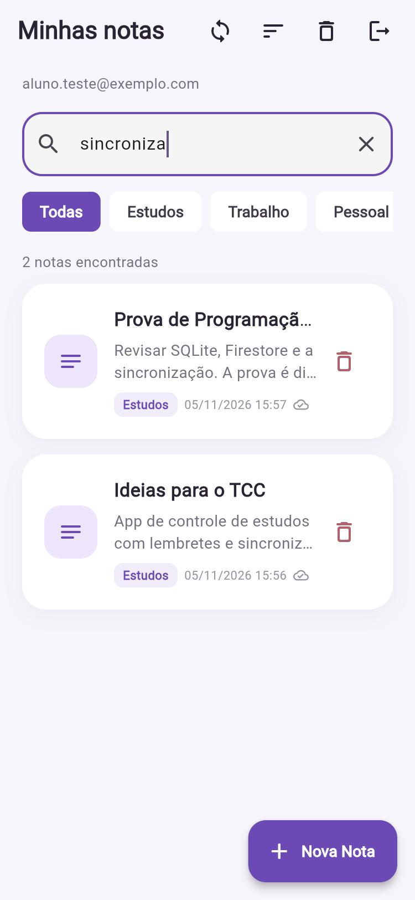 | 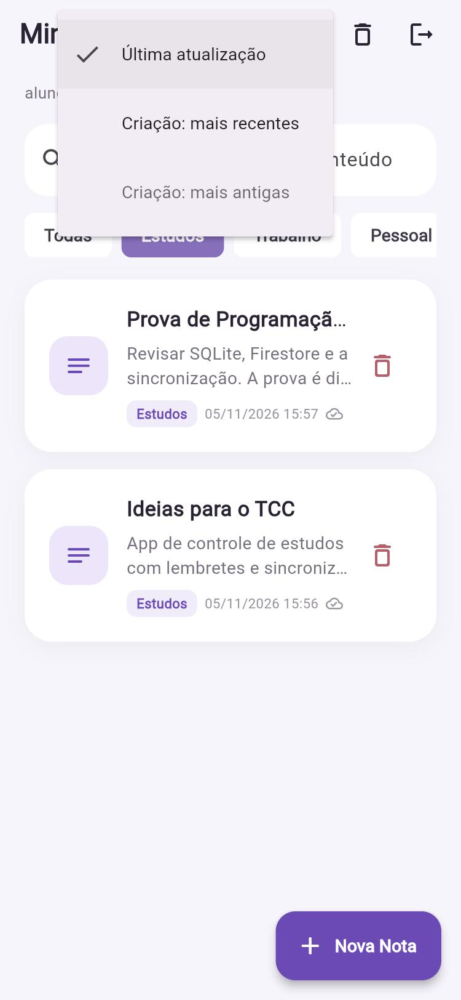 |

| Lixeira | Sem conexão com o Firebase |
| :---: | :---: |
| 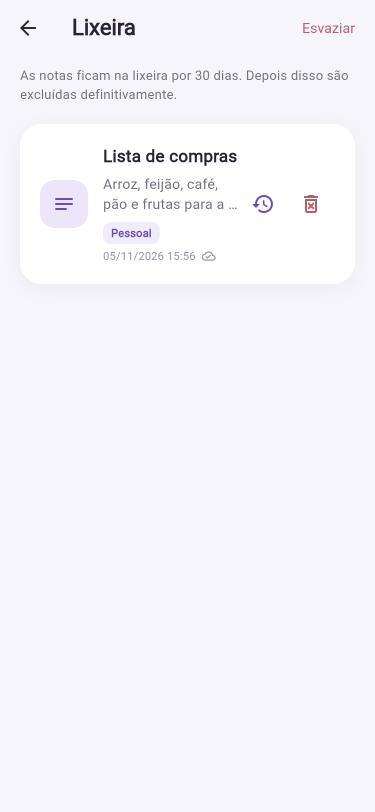 | 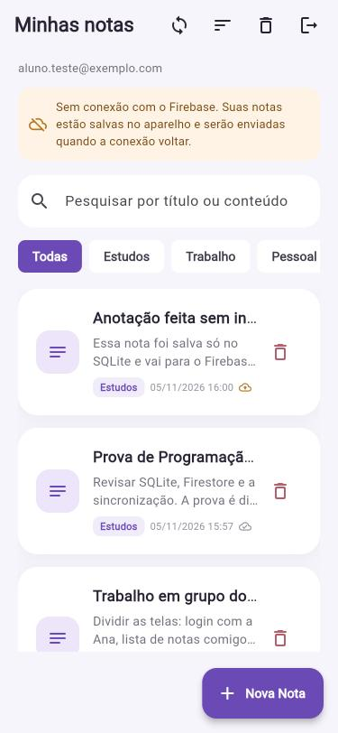 |

Na última imagem o Firebase estava fora do ar: a nota "Anotação feita sem internet" foi salva no SQLite e ficou com o ícone de nuvem com seta (pendente). Quando a conexão voltou, a sincronização enviou a nota e o ícone mudou.

### Evidências no Firebase

Projeto usado nos testes: `bloco-de-notas-emanuel`. As notas criadas pelo app ficam em `users/{uid}/notes`. Na imagem aparecem a coleção `users`, o documento com o `uid` do usuário, a subcoleção `notes` com as notas e os campos de uma delas (`category`, `content`, `createdAt`, `date`, `title`, `trashed`, `uid` e `updatedAt`).

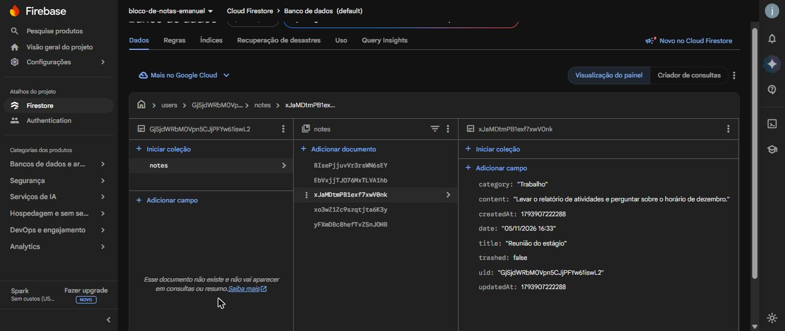

Usuário cadastrado pelo app no Firebase Authentication. O UID é o mesmo que aparece no caminho das notas no Firestore:

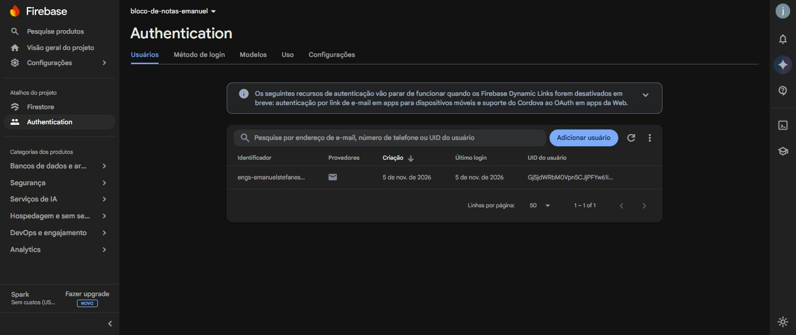

Regras publicadas no Firestore (mesmo conteúdo do arquivo `firestore.rules`):

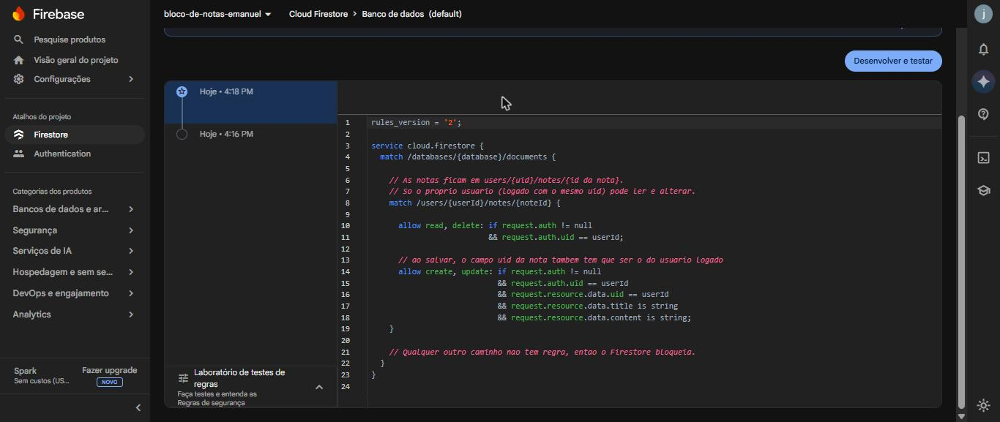

Teste das regras no Laboratório de testes do console, tentando ler uma nota do usuário acima. Com o UID de outro usuário a leitura é **negada**. Com o UID do dono da nota a leitura é **permitida**:

| Outro usuário | Dono da nota |
| :---: | :---: |
| 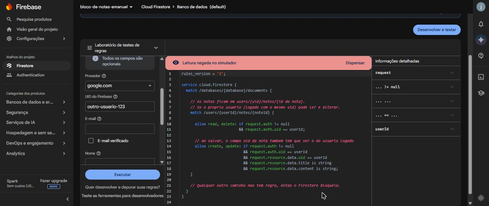 | 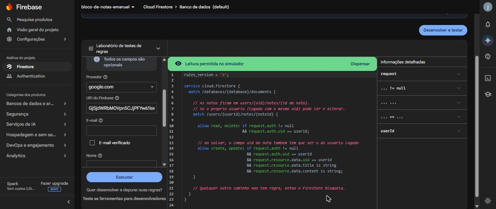 |

## O que foi alterado em relação ao projeto base

| Arquivo | O que mudou |
| --- | --- |
| `lib/models/note.dart` | novos campos (`firebaseId`, `category`, `createdAt`, `updatedAt`, `synced`, `trashed`, `deleted`), `toFirestore`, `fromFirestore` e `copyWith` |
| `lib/database/database_helper.dart` | correção do `CREATE TABLE`, versões 2 e 3 com migração, tabela `categories`, pesquisa, filtro, ordenação, lixeira e consultas da sincronização |
| `lib/services/firestore_service.dart` | **novo**: acesso ao Firestore |
| `lib/repositories/note_repository.dart` | **novo**: regras de gravação local, lixeira e sincronização |
| `lib/pages/notes_page.dart` | pesquisa, filtro por categoria, ordenação, botão de sincronizar, aviso de erro de conexão, lixeira |
| `lib/pages/note_form_page.dart` | escolha e criação de categoria, salvamento pelo repository |
| `lib/pages/trash_page.dart` | **novo**: tela da lixeira |
| `lib/widgets/note_card.dart` | categoria, ícone de sincronização e botões da lixeira |
| `lib/pages/login_page.dart` e `register_page.dart` | mensagens de erro pelo código do Firebase Auth |
| `lib/main.dart` | SQLite na web, cache do Firestore desligado e abertura direto nas notas se já estiver logado |
| `firestore.rules` e `firebase.json` | regras de segurança do Firestore |
| `.gitignore` | arquivos de configuração do Firebase fora do repositório |
| `pubspec.yaml` | `cloud_firestore` e `sqflite_common_ffi_web` |
| `web/sqflite_sw.js` e `web/sqlite3.wasm` | arquivos do SQLite para web |
| `test/note_test.dart` | testes do model |
